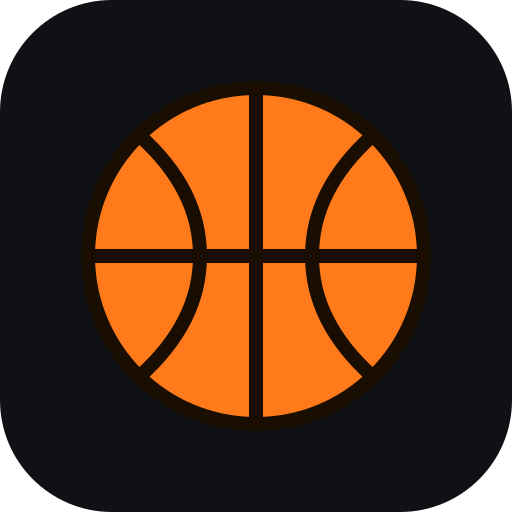
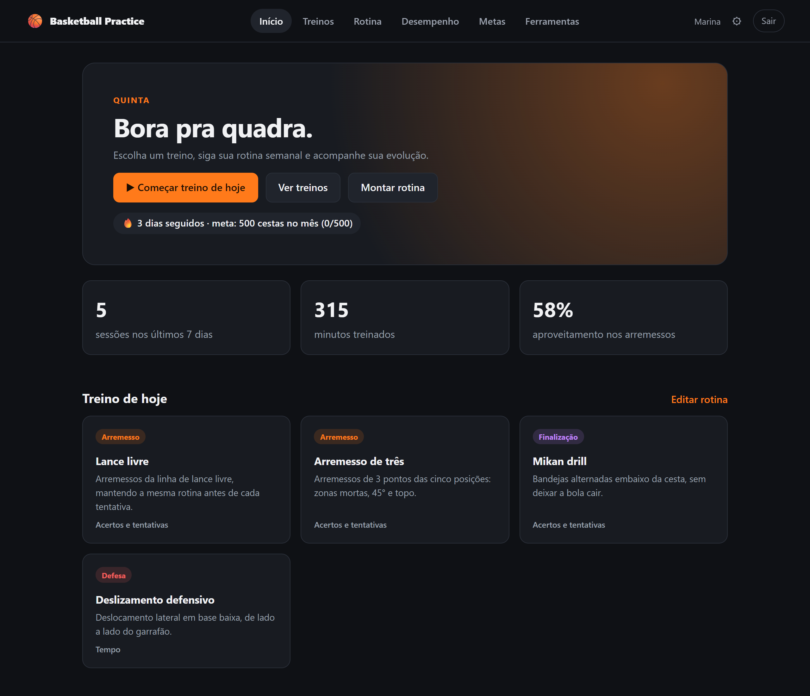
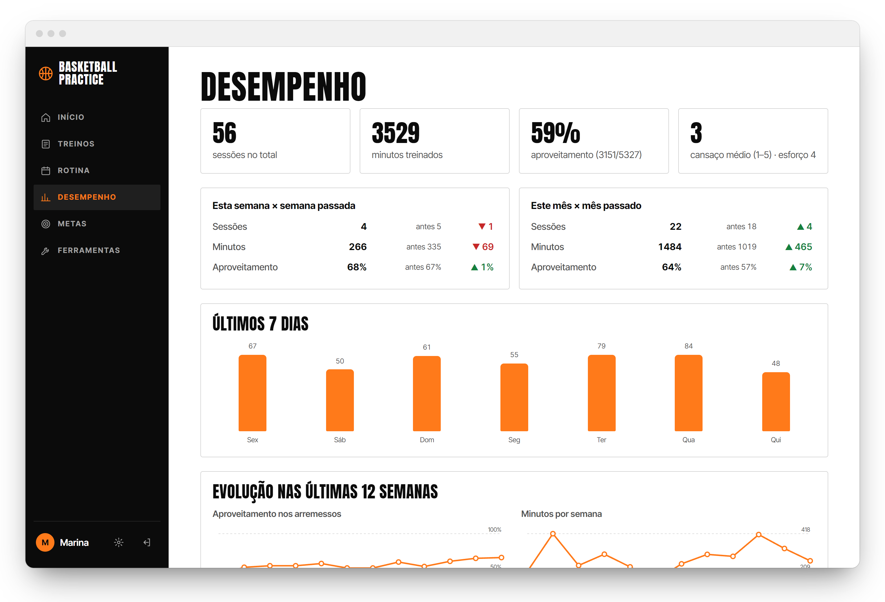
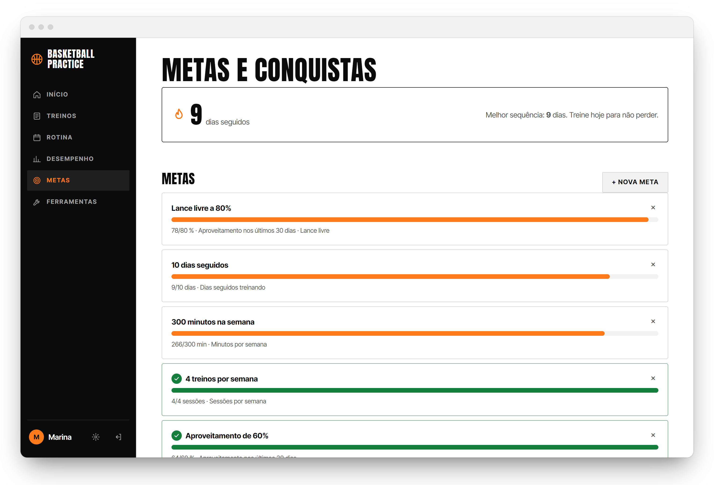
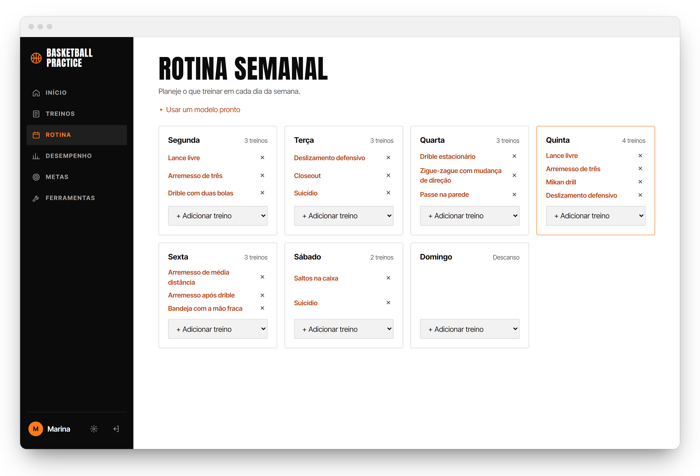
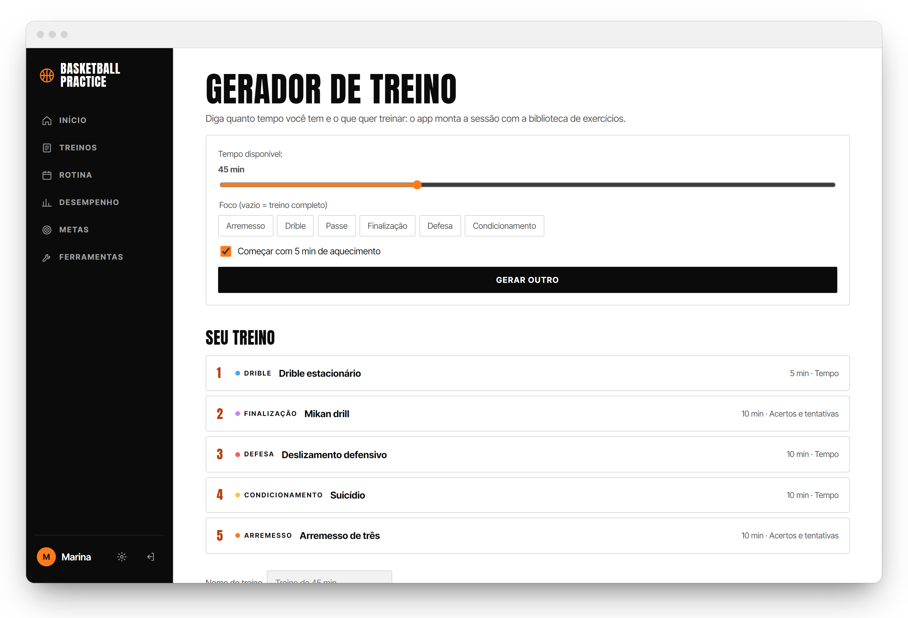
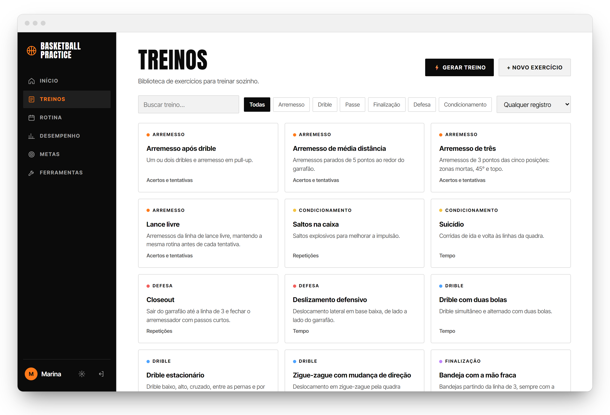
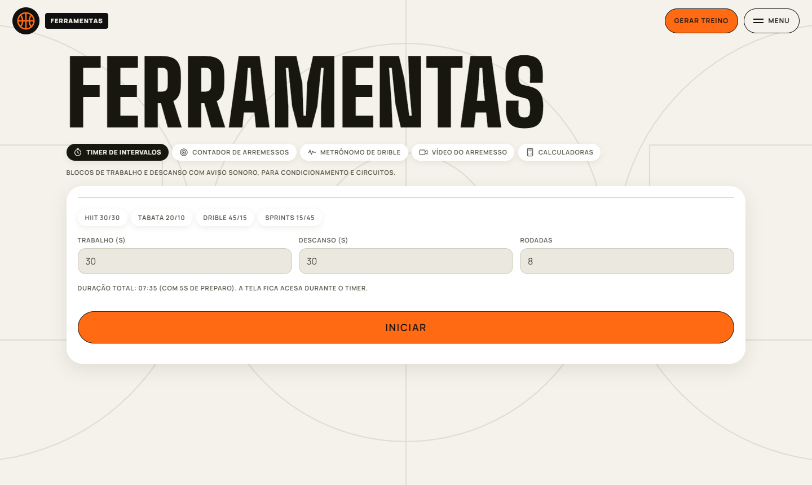
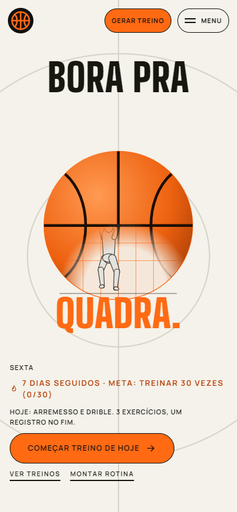
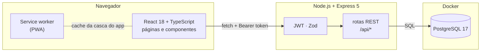

<div align="center">



# Basketball Practice

**Seu treino de basquete organizado: rotina semanal, sessões guiadas e evolução em números.**

Um app web para atletas planejarem o que treinar, registrarem cada arremesso e acompanharem o próprio progresso.


[Funcionalidades](#-funcionalidades) · [Telas](#-telas) · [Como rodar](#-como-rodar) · [Arquitetura](#-arquitetura) · [Documentação](docs/DOCUMENTACAO.md)

<br />



</div>

---

## ✨ Funcionalidades

| | Recurso | O que faz |
| :-: | --- | --- |
| 🗓️ | **Rotina semanal** | Monte o que treinar em cada dia ou comece de um modelo pronto. A tela inicial já mostra o treino de hoje. |
| ⚡ | **Gerador de treino** | Diga quanto tempo tem e o foco (arremesso, drible, defesa…): o app monta a sessão com a biblioteca de exercícios. |
| ▶️ | **Sessão guiada** | Passo a passo do treino com cronômetro, contador de acertos e registro automático no fim. |
| 🎯 | **Mapa de arremessos** | Acertos e tentativas por zona da quadra, com cores do quente ao frio. |
| 📈 | **Desempenho** | Totais, aproveitamento, comparação semana × semana e mês × mês, gráfico dos últimos 7 dias e evolução de 12 semanas. |
| 🏆 | **Metas e conquistas** | Metas com barra de progresso, sequência de dias seguidos e medalhas desbloqueáveis. |
| 🧰 | **Ferramentas** | Timer de intervalos (HIIT, Tabata), contador de arremessos, metrônomo de drible, vídeo em câmera lenta e calculadoras. |
| 🧪 | **Testes físicos** | Registre impulsão vertical, sprint e outros testes e veja o recorde de cada um. |
| 💾 | **Backup** | Exporte e importe tudo em JSON (sem duplicar) ou baixe as sessões em CSV. |
| 📱 | **PWA** | Instalável no celular, funciona offline para as ferramentas, com tema claro/escuro e lembretes de treino. |
| 🛡️ | **Painel admin** | Administradores veem todas as contas, promovem outros admins e excluem contas. |

## 📸 Telas

<table>
  <tr>
    <td width="50%"></td>
    <td width="50%"></td>
  </tr>
  <tr>
    <td align="center"><b>Desempenho</b> · comparativos, gráficos e mapa de arremessos</td>
    <td align="center"><b>Metas e conquistas</b> · sequência, metas e medalhas</td>
  </tr>
  <tr>
    <td></td>
    <td></td>
  </tr>
  <tr>
    <td align="center"><b>Rotina semanal</b> · o dia de hoje em destaque</td>
    <td align="center"><b>Gerador</b> · um treino completo em um clique</td>
  </tr>
  <tr>
    <td></td>
    <td></td>
  </tr>
  <tr>
    <td align="center"><b>Treinos</b> · biblioteca por categoria</td>
    <td align="center"><b>Ferramentas</b> · timer, contador, metrônomo e mais</td>
  </tr>
</table>

<div align="center">
  
  <br />
  <sub>Feito para usar na quadra, direto do celular.</sub>
</div>

## 🚀 Como rodar

**Pré-requisitos:** [Node.js](https://nodejs.org) 22.13 ou mais novo e [Docker Desktop](https://www.docker.com/products/docker-desktop/).

### 1. Banco de dados

```bash
cd backend
npm install
cp .env.example .env
npm run db:up
```

O Postgres sobe no Docker em `localhost:5433`.

### 2. API

```bash
cd backend
npm run dev
```

A API roda em `http://localhost:3333/api` e aplica as migrações e o catálogo de exercícios sozinha na primeira vez.

### 3. Site

```bash
cd frontend
npm install
npm run dev
```

Abra **http://localhost:5173**, crie sua conta e bora pra quadra. 🏀

### 4. (Opcional) Virar administrador

Depois de criar a conta pelo site, rode na pasta `backend`:

```bash
npm run admin -- seu@email.com
```

O link **Admin** aparece no menu. Para tirar o papel, acrescente `--remover`.

## 🧱 Arquitetura



| Camada | Tecnologias |
| --- | --- |
| **Frontend** | React 18, TypeScript, Vite, React Router, CSS puro, service worker, IndexedDB (vídeos) |
| **Backend** | Node.js 24, Express 5, Zod, JWT, senhas com `scrypt`, SQL escrito à mão com `pg` |
| **Banco** | PostgreSQL 17 no Docker Compose, migrações versionadas |
| **Testes** | `node:test` + PGlite na API; Vitest + Testing Library no site |

<details>
<summary><b>Estrutura de pastas</b></summary>

```
BasketballPractice/
├── backend/
│   ├── src/
│   │   ├── app.ts            montagem do Express e das rotas
│   │   ├── server.ts         ponto de entrada
│   │   ├── db/               conexão, migrações e catálogo de exercícios
│   │   ├── lib/              senha, JWT, validação e erros HTTP
│   │   ├── middleware/       autenticação, admin e tratamento de erros
│   │   ├── routes/           auth, admin, exercises, workouts, sessions, stats, goals, tests, plans, settings, data
│   │   └── scripts/          comando para promover administradores
│   ├── test/                 testes de integração com PGlite
│   └── docker-compose.yml
├── frontend/
│   ├── public/               ícone, manifest e service worker
│   └── src/
│       ├── pages/            uma página por rota
│       ├── components/       quadra, gráficos, cartões e layout
│       ├── ferramentas/      timer, contador, metrônomo, vídeo e calculadoras
│       ├── api.ts            cliente da API
│       └── store.ts          estado e cache
└── docs/
    ├── DOCUMENTACAO.md       documentação técnica completa
    └── screenshots/
```

</details>

## 🧪 Testes

| Onde | Comando | Ferramentas | O que cobre |
| --- | --- | --- | --- |
| **API** | `cd backend && npm test` | `node:test` + PGlite | A API inteira contra um Postgres em memória: cadastro e login, tokens adulterados e vencidos, isolamento entre atletas em cada recurso, validações, sessões, estatísticas com fuso horário, mapa de arremessos, metas, conquistas, gerador, backup tudo-ou-nada e permissões de admin |
| **Site** | `cd frontend && npm test` | Vitest + Testing Library | Cálculos, CSV, lembretes, cliente da API, quadra, contador, login e cadastro, rotas protegidas, painel admin, início, biblioteca e criação de exercícios, desempenho (totais, comparações, gráficos, mapa, excluir sessão), ferramentas (calculadoras, timer, metrônomo, contador de arremessos), sessão guiada, registro de treino, rotina, metas, gerador e configurações |

Nenhum dos dois precisa de Docker nem de servidor rodando.

## 📚 Documentação

A [documentação técnica](docs/DOCUMENTACAO.md) detalha a arquitetura, todas as rotas da API, o modelo de dados, as decisões de projeto e o que ainda está por vir.

## 🗺️ Próximos passos

- [x] Testes automatizados do frontend
- [ ] Testes de ponta a ponta (navegador + API + banco)
- [ ] Notificações push com o app fechado
- [ ] Edição de treinos salvos com séries e metas
- [ ] Deploy em produção

---

<div align="center">
  <sub>Feito com 🧡 e muitos arremessos por <a href="https://github.com/EduardoLafaiety">Eduardo Lopes</a>.</sub>
</div>
