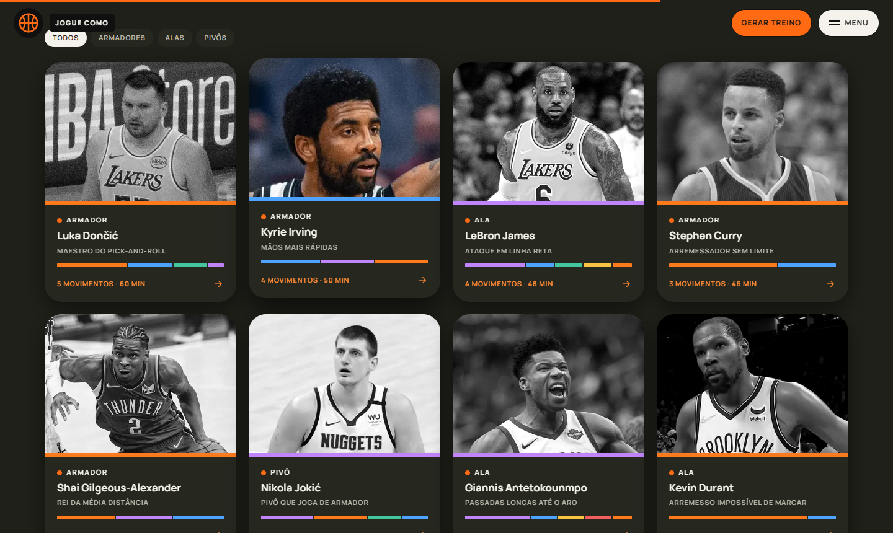
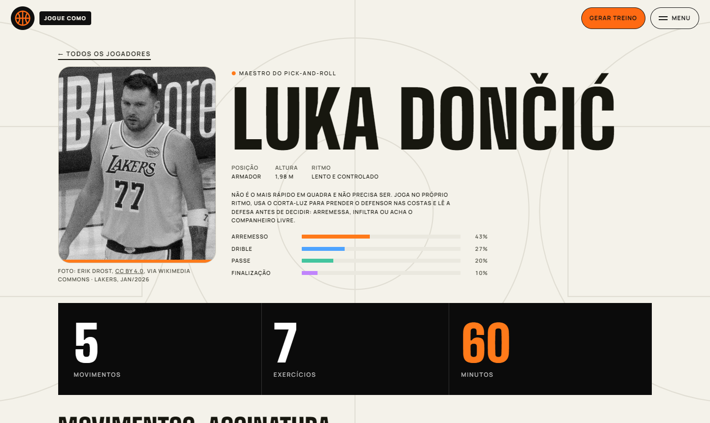
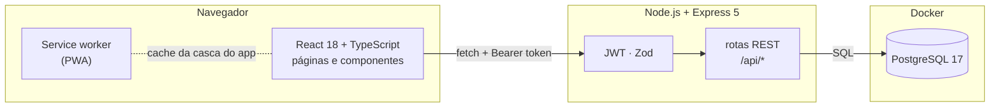

<div align="center">


# Basketball Practice

**Do primeiro quique à jogada de decisão: treinos em três níveis, figuras animadas para cada movimento e sua evolução em números.**

Um app web para atletas planejarem o que treinar, seguirem sessões guiadas e acompanharem o próprio progresso, numa página contínua que se anima conforme você rola.


[Funcionalidades](#-funcionalidades) · [Telas](#-telas) · [Como rodar](#-como-rodar) · [Arquitetura](#-arquitetura) · [Documentação](docs/DOCUMENTACAO.md)

**[▶ Experimente a demonstração](https://eduardolafaiety.github.io/BasketballPractice/)**: sem cadastro, direto no navegador, começando do zero como uma conta nova.

<br />


</div>

---

## ✨ Funcionalidades

| | Recurso | O que faz |
| :-: | --- | --- |
| 🏀 | **Página contínua** | A página inicial é uma rolagem única: a bola fica transparente sob o mouse e revela o atleta, o boneco anda com a rolagem e treinos, jogadores, rotina e números vão aparecendo. A navegação fica num menu em tela cheia. |
| 📶 | **Três níveis** | Iniciante, intermediário e avançado, com 50 exercícios em cada um e um aquecimento próprio, sempre do mais simples ao mais difícil. O iniciante foca em controle de bola e na forma certa de arremessar. |
| 🔥 | **Aquecimento em ordem** | De 10 a 11 passos por nível, do geral ao específico e, no arremesso, de perto para longe da cesta: ninguém começa arremessando de três. |
| 🗓️ | **Rotina semanal** | Monte o que treinar em cada dia ou comece de um modelo pronto. A página inicial já mostra o treino de hoje. |
| ⚡ | **Gerador de treino** | Diga quanto tempo tem, o nível e o foco (arremesso, drible, defesa…): o app começa pelo aquecimento e monta a sessão do mais fácil ao mais difícil. |
| 🌟 | **Jogue como** | Escolha um jogador da NBA (Luka, Curry, Jokić, Wembanyama e mais 16) e treine os movimentos que definem o estilo dele, com uma sessão pronta. |
| 🎬 | **Como fazer** | Cada um dos 181 exercícios do catálogo tem uma animação de um manequim mostrando o movimento passo a passo, com os músculos em ação, o rastro das poses e as pegadas vistas de cima. |
| ▶️ | **Sessão guiada** | Passo a passo do treino com a animação do movimento ao lado do cronômetro, contador de acertos e registro automático no fim. |
| 🎯 | **Mapa de arremessos** | Acertos e tentativas por zona da quadra, com cores do quente ao frio. |
| 📈 | **Desempenho** | Totais, aproveitamento, comparação semana × semana e mês × mês, gráfico dos últimos 7 dias e evolução de 12 semanas. |
| 🏆 | **Metas e conquistas** | Metas com barra de progresso, sequência de dias seguidos e medalhas desbloqueáveis. |
| 🧰 | **Ferramentas** | Timer de intervalos (HIIT, Tabata), contador de arremessos, metrônomo de drible, vídeo em câmera lenta e calculadoras. |
| 🧪 | **Testes físicos** | Registre impulsão vertical, sprint e outros testes e veja o recorde de cada um. |
| 💾 | **Backup** | Exporte e importe tudo em JSON (sem duplicar) ou baixe as sessões em CSV. |
| 📱 | **PWA** | Instalável no celular, funciona offline para as ferramentas, com tema claro/escuro e lembretes de treino. |
| 📰 | **Barra de notícias** | Manchetes de basquete correndo no rodapé, com fonte e link para a matéria. As automáticas vêm do [GNews](https://gnews.io) e os admins publicam as "Breaking news". |
| 🛡️ | **Painel admin** | Administradores veem todas as contas, promovem outros admins, excluem contas e cuidam da barra de notícias. |

## 📸 Telas

<table>
  <tr>
    <td width="50%"></td>
    <td width="50%"></td>
  </tr>
  <tr>
    <td align="center"><b>Desempenho</b> · comparativos, gráficos e mapa de arremessos</td>
    <td align="center"><b>Metas e conquistas</b> · sequência, metas e medalhas</td>
  </tr>
  <tr>
    <td></td>
    <td></td>
  </tr>
  <tr>
    <td align="center"><b>Rotina semanal</b> · o dia de hoje em destaque</td>
    <td align="center"><b>Gerador</b> · um treino completo em um clique</td>
  </tr>
  <tr>
    <td></td>
    <td></td>
  </tr>
  <tr>
    <td align="center"><b>Treinos</b> · três níveis, com o aquecimento primeiro</td>
    <td align="center"><b>Ferramentas</b> · timer, contador, metrônomo e mais</td>
  </tr>
  <tr>
    <td></td>
    <td></td>
  </tr>
  <tr>
    <td align="center"><b>Jogue como</b> · 20 jogadores; o mouse revela a cor da foto</td>
    <td align="center"><b>Perfil do jogador</b> · estilo, movimentos e treino pronto</td>
  </tr>
</table>

<div align="center">
  
  <br />
  <sub>Feito para usar na quadra, direto do celular.</sub>
</div>

## 🚀 Como rodar

**Pré-requisitos:** [Node.js](https://nodejs.org) 22.13 ou mais novo e [Docker Desktop](https://www.docker.com/products/docker-desktop/).

### 1. Banco de dados

```bash
cd backend
npm install
cp .env.example .env
npm run db:up
```

O Postgres sobe no Docker em `localhost:5433`.

### 2. API

```bash
cd backend
npm run dev
```

A API roda em `http://localhost:3333/api` e aplica as migrações e o catálogo de exercícios sozinha na primeira vez.

### 3. Site

```bash
cd frontend
npm install
npm run dev
```

Abra **http://localhost:5173**, crie sua conta e bora pra quadra. 🏀

### 4. (Opcional) Virar administrador

Depois de criar a conta pelo site, rode na pasta `backend`:

```bash
npm run admin -- seu@email.com
```

O link **Admin** aparece no menu. Para tirar o papel, acrescente `--remover`.

### 5. (Opcional) Notícias automáticas na barra

Crie uma chave grátis em [gnews.io](https://gnews.io) e coloque em `backend/.env`:

```bash
GNEWS_API_KEY=sua-chave
```

Reinicie a API. Sem a chave, a barra mostra só as manchetes publicadas no painel admin. O plano grátis é para uso não comercial e entrega as notícias com 12 horas de atraso. Para a demonstração online, cadastre a mesma chave como secret `GNEWS_API_KEY` no GitHub. Sem ela, a demonstração mostra as manchetes escritas à mão em `backend/src/lib/curated-news.ts`, que não se atualizam sozinhas.

### Versão de demonstração (sem banco nem API)

A [demonstração online](https://eduardolafaiety.github.io/BasketballPractice/) é o mesmo site, sem login, começando zerado como no primeiro acesso: só o catálogo de exercícios, sem nenhum treino registrado. Ela roda **as rotas reais do backend dentro do navegador**, sobre o [PGlite](https://pglite.dev) (Postgres em WebAssembly), e guarda os dados no próprio navegador: mesmas regras, mesmos cálculos e mesmas validações do site com API.

Para rodar na sua máquina, instale as dependências do `backend` e do `frontend` (`npm install` em cada pasta) e, em `frontend`:

```bash
npm run dev:demo
```

Ela é publicada no GitHub Pages pelo workflow [`demo.yml`](.github/workflows/demo.yml) a cada push na `main`. O código fica em [`frontend/src/demo`](frontend/src/demo) e só entra no build com `--mode demo`: o site normal não carrega nada dela.

## 🧱 Arquitetura



| Camada | Tecnologias |
| --- | --- |
| **Frontend** | React 18, TypeScript, Vite, React Router, CSS puro, animações em SVG sem biblioteca externa, service worker, IndexedDB (vídeos) |
| **Backend** | Node.js 24, Express 5, Zod, JWT, senhas com `scrypt`, SQL escrito à mão com `pg` |
| **Banco** | PostgreSQL 17 no Docker Compose, migrações versionadas |
| **Testes** | `node:test` + PGlite na API; Vitest + Testing Library no site; Playwright + Postgres de ponta a ponta |

<details>
<summary><b>Estrutura de pastas</b></summary>

```
BasketballPractice/
├── backend/
│   ├── src/
│   │   ├── app.ts            montagem do Express e das rotas
│   │   ├── server.ts         ponto de entrada
│   │   ├── db/               conexão, migrações e catálogo de exercícios por nível (catalog.ts)
│   │   ├── lib/              senha, JWT, validação e erros HTTP
│   │   ├── middleware/       autenticação, admin e tratamento de erros
│   │   ├── routes/           auth, admin, exercises, workouts, sessions, stats, goals, tests, plans, styles, settings, data
│   │   └── scripts/          comando para promover administradores
│   ├── test/                 testes de integração com PGlite
│   └── docker-compose.yml
├── frontend/
│   ├── public/               ícone, manifest e service worker
│   └── src/
│       ├── pages/            uma página por rota
│       ├── components/       quadra, gráficos, cartões, menu e peças animadas pela rolagem
│       ├── demonstracoes/    motor das animações e as figuras de cada exercício
│       ├── lib/              efeitos de rolagem e mouse, níveis, lembretes e tema
│       ├── ferramentas/      timer, contador, metrônomo, vídeo e calculadoras
│       ├── assets/jogadores/ fotos dos jogadores (Wikimedia Commons) e créditos
│       ├── demo/             versão de demonstração: a API rodando no navegador
│       ├── api.ts            cliente da API
│       └── store.ts          estado e cache
├── e2e/                      testes de ponta a ponta (Playwright)
├── .github/workflows/        testes e publicação da demonstração
└── docs/
    ├── DOCUMENTACAO.md       documentação técnica completa
    └── screenshots/
```

</details>

## 🧪 Testes

| Onde | Comando | Ferramentas | O que cobre |
| --- | --- | --- | --- |
| **API** | `cd backend && npm test` | `node:test` + PGlite | A API inteira contra um Postgres em memória: cadastro e login, tokens adulterados e vencidos, isolamento entre atletas em cada recurso, validações, sessões, estatísticas com fuso horário, mapa de arremessos, metas, conquistas, gerador, estilos de jogo ligados ao catálogo, catálogo em três níveis que atualiza bancos antigos, gerador com aquecimento e progressão, backup tudo-ou-nada, permissões de admin e notícias (busca no GNews sem gastar a cota à toa, manchetes do admin, prazo e remoção) |
| **Site** | `cd frontend && npm test` | Vitest + Testing Library | Cálculos, CSV, lembretes, cliente da API, quadra, contador, login e cadastro, rotas protegidas, painel admin, início, biblioteca e criação de exercícios, desempenho (totais, comparações, gráficos, mapa, excluir sessão), ferramentas (calculadoras, timer, metrônomo, contador de arremessos), sessão guiada, registro de treino, rotina, metas, gerador, a aba Jogue como (lista, filtro, perfil, sessão guiada) com foto e crédito para cada jogador, barra de notícias, configurações, menu em tela cheia, efeitos de rolagem e as 181 figuras (cena, fases e pés no chão) |
| **Ponta a ponta** | `cd e2e && npm test` | Playwright + Chrome + Postgres 17 | O site de produção no navegador falando com a API real e um Postgres de verdade: cadastro, login e volta à página pedida, e-mail repetido, rotina do dia → sessão guiada → desempenho, metas e conquistas, exercício próprio que não pode ser excluído quando está em uso, meta semanal no fuso do atleta, tema salvo na conta, backup sem duplicar, painel admin, manchete do admin na barra de notícias, navegação no celular e a aba Jogue como (os 20 estilos ligados ao catálogo do Postgres, filtro, perfil, sessão guiada salva no banco e treino do estilo na rotina) |

Os testes da API e do site não precisam de Docker nem de servidor rodando. Os de ponta a ponta precisam do Postgres do Docker (`cd backend && npm run db:up`) e do Google Chrome instalado. Eles sobem sozinhos a API e o site em portas próprias (3410 e 4410) e usam um banco separado, `basketball_e2e`, recriado vazio a cada execução: o banco de desenvolvimento não é tocado. Na primeira vez, rode `npm install` dentro de `e2e`. O relatório de cada execução fica em `npm run report`.

Os três rodam no GitHub Actions a cada push e pull request na `main` ([`testes.yml`](.github/workflows/testes.yml)).

## 📚 Documentação

A [documentação técnica](docs/DOCUMENTACAO.md) detalha a arquitetura, todas as rotas da API, o modelo de dados, as decisões de projeto e o que ainda está por vir.

## 🗺️ Próximos passos

- [x] Testes automatizados do frontend
- [x] Testes de ponta a ponta (navegador + API + banco)
- [x] Exercícios em três níveis, com aquecimento e figuras animadas
- [x] Página contínua com efeitos de rolagem e mouse
- [ ] Notificações push com o app fechado
- [ ] Edição de treinos salvos com séries e metas
- [ ] Deploy em produção

---

<div align="center">
  <sub>Feito com 🧡 e muitos arremessos por <a href="https://github.com/EduardoLafaiety">Eduardo Lopes</a>.</sub>
</div>
