

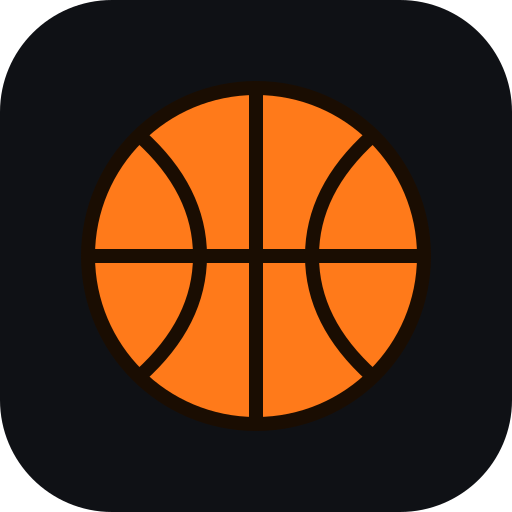

# Basketball Practice

**Do Primeiro Quique À Jogada De Decisão: Treinos Em Três Níveis, Figuras Animadas Para Cada Movimento E Sua Evolução Em Números.**

**[▶ Experimente A Demonstração](https://eduardolafaiety.github.io/BasketballPractice/)**: Entre Com Qualquer E-Mail E Senha Ou Sem Conta, Direto No Navegador.

 

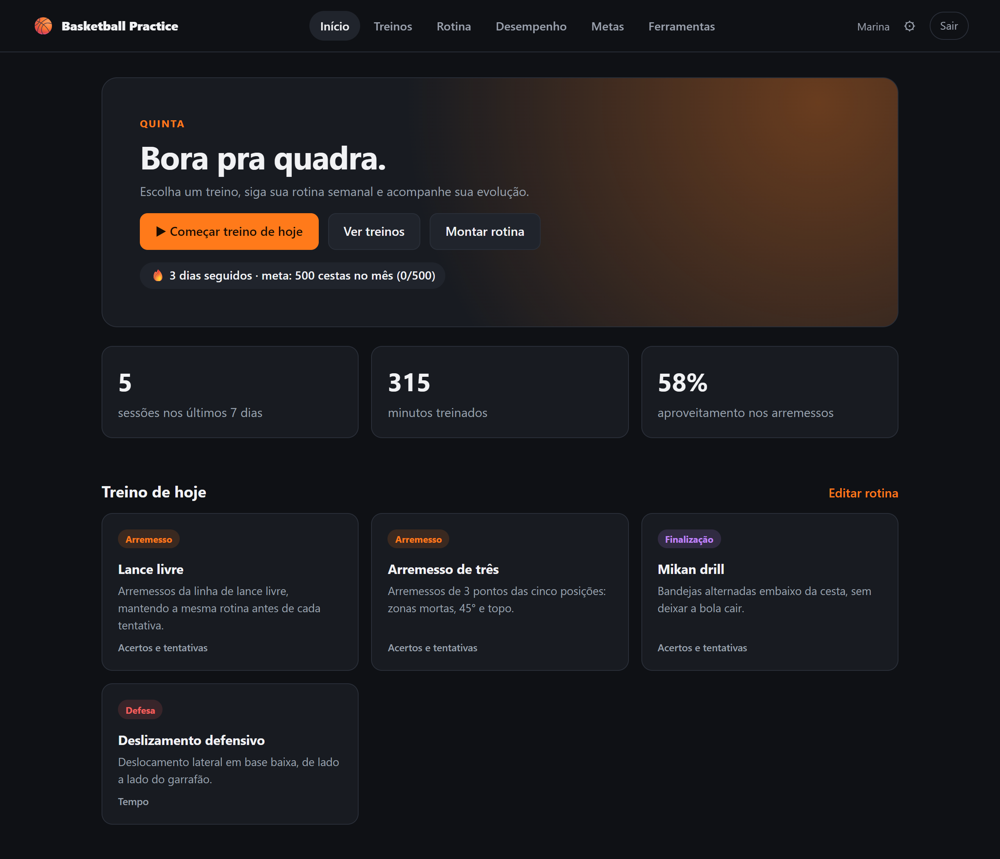

---

## ✨ O Que Tem.

- 📶 **Três Níveis**: Iniciante, Intermediário E Avançado, Com 50 Exercícios Em Cada Um E Aquecimento Próprio.
- 🎬 **Como Fazer**: Os 181 Exercícios Do Catálogo Têm Uma Animação De Um Manequim Mostrando O Movimento.
- ⚡ **Gerador De Treino**: Diga Quanto Tempo Tem, O Nível E O Foco, E A Sessão Sai Pronta.
- 🌟 **Jogue Como**: Escolha Um Entre 28 Jogadores Da NBA E Treine Os Movimentos Que Definem O Estilo Dele.
- ▶️ **Sessão Guiada**: Animação Ao Lado Do Cronômetro, Contador De Acertos E Registro Automático No Fim.
- 🗓️ **Rotina Semanal**: Monte O Que Treinar Em Cada Dia Ou Comece De Um Modelo Pronto.
- 📈 **Desempenho**: Comparativos, Gráficos E Mapa De Arremessos Por Zona Da Quadra.
- 🏆 **Metas E Conquistas**: Barras De Progresso, Sequência De Dias Seguidos E Medalhas.
- 🎯 **Desafio Do Dia E Quiz Diário**: O Mesmo Desafio De Quadra E As Mesmas 5 Perguntas Para Todo Mundo, Trocados À Meia-Noite, Com Placar Em Quadradinhos Para Compartilhar.
- 🪪 **Cartão Do Atleta**: Bateria Mensal De Quatro Testes, Nota De 0 A 99, Radar E Evolução Mês A Mês.
- 📅 **Programas De 30 Dias**: Um Treino Liberado Por Dia, Com Barra De Progresso.
- 🥇 **Ranking E Desafios Entre Amigos**: Listas Da Semana E Gerais, Convite Por Link E Duelos Semanais.
- 📋 **Modo Técnico**: Times, Tarefas E O Acompanhamento De Cada Atleta.
- 📓 **Diário De Jogos**: As Partidas De Verdade, Comparadas Com O Treino.
- 🗺️ **Quadras Perto De Você E Prancheta Tática**: Mapa Com Quadras Do OpenStreetMap E Jogadas Desenhadas Em Meia Ou Quadra Inteira.
- 🖼️ **Imagem Da Semana**: PNG No Tamanho Dos Stories Com O Mapa De Arremessos E A Sequência.
- 🧰 **Ferramentas**: Timer De Intervalos, Contador De Arremessos, Metrônomo De Drible E Calculadoras; O Vídeo Em Câmera Lenta Chega Em Breve.
- 📰 **Barra De Notícias**: As Últimas Manchetes Do Basquete Correndo No Rodapé Do Site.
- 🏀 **Visual De Quadra**: A Bola Da Abertura Amplia Sem Perder Nitidez Ao Rolar A Página, E Uma Listra Com As Costuras Dela Abre As Seções De Números E Ferramentas.
- 📱 **PWA**: Instalável No Celular, Com Tema Claro/Escuro E Lembretes De Treino, Inclusive Com O App Fechado (Web Push).

## 📸 Telas

<table>
  <tr>
    <td width="50%">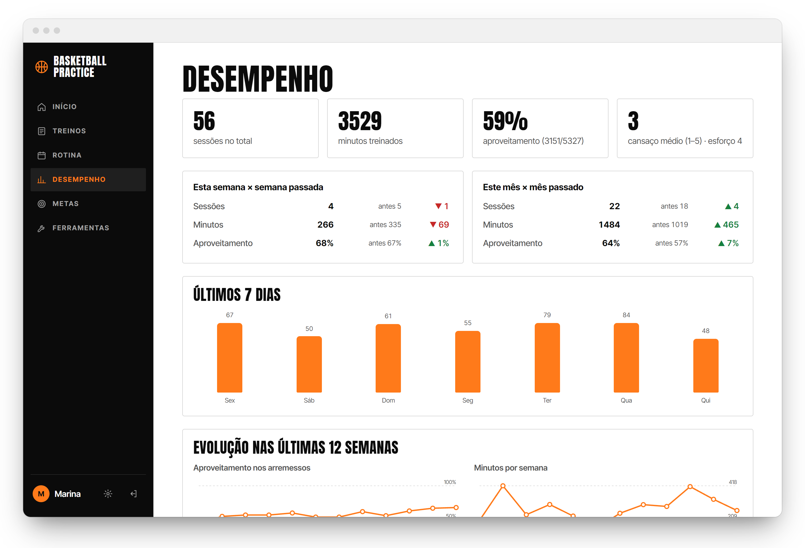</td>
    <td width="50%">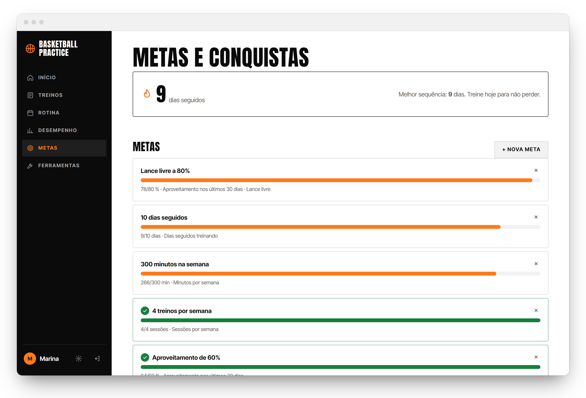</td>
  </tr>
  <tr>
    <td align="center"><b>Desempenho</b> · Comparativos, Gráficos E Mapa De Arremessos</td>
    <td align="center"><b>Metas E Conquistas</b> · Sequência, Metas E Medalhas</td>
  </tr>
  <tr>
    <td>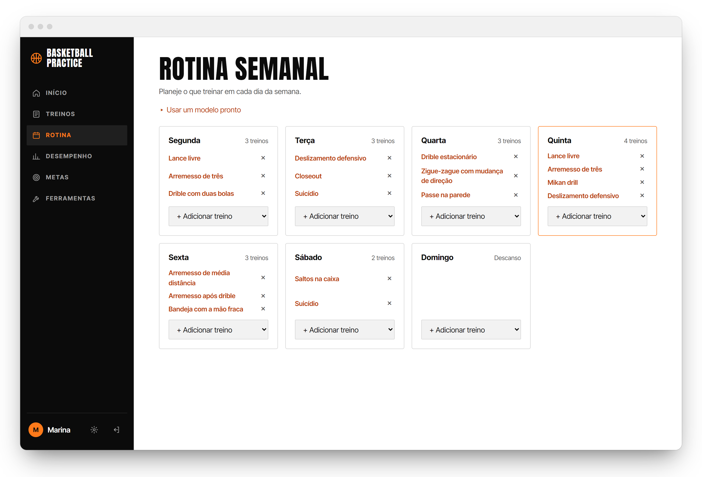</td>
    <td>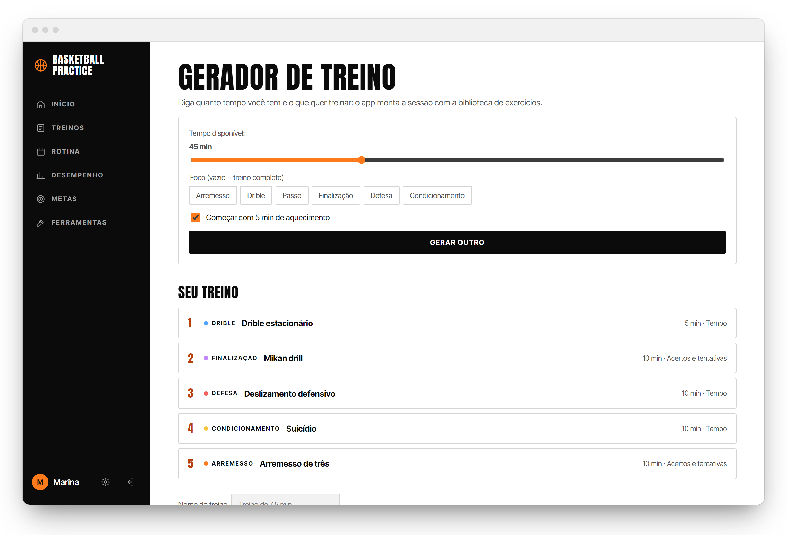</td>
  </tr>
  <tr>
    <td align="center"><b>Rotina Semanal</b> · O Dia De Hoje Em Destaque</td>
    <td align="center"><b>Gerador</b> · Um Treino Completo Em Um Clique</td>
  </tr>
  <tr>
    <td>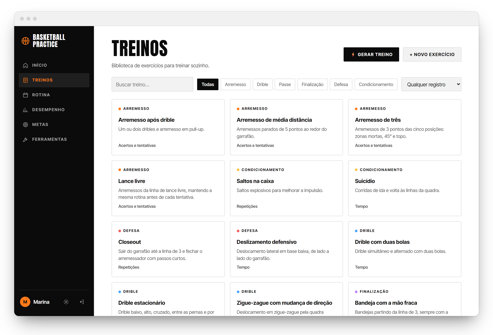</td>
    <td>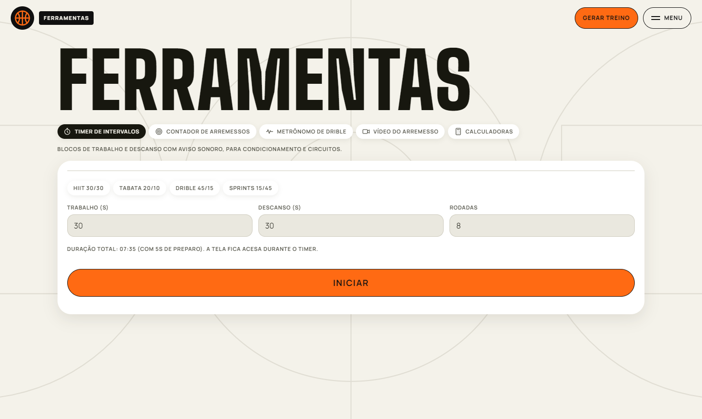</td>
  </tr>
  <tr>
    <td align="center"><b>Treinos</b> · Três Níveis, Com O Aquecimento Primeiro</td>
    <td align="center"><b>Ferramentas</b> · Timer, Contador, Metrônomo E Mais</td>
  </tr>
  <tr>
    <td>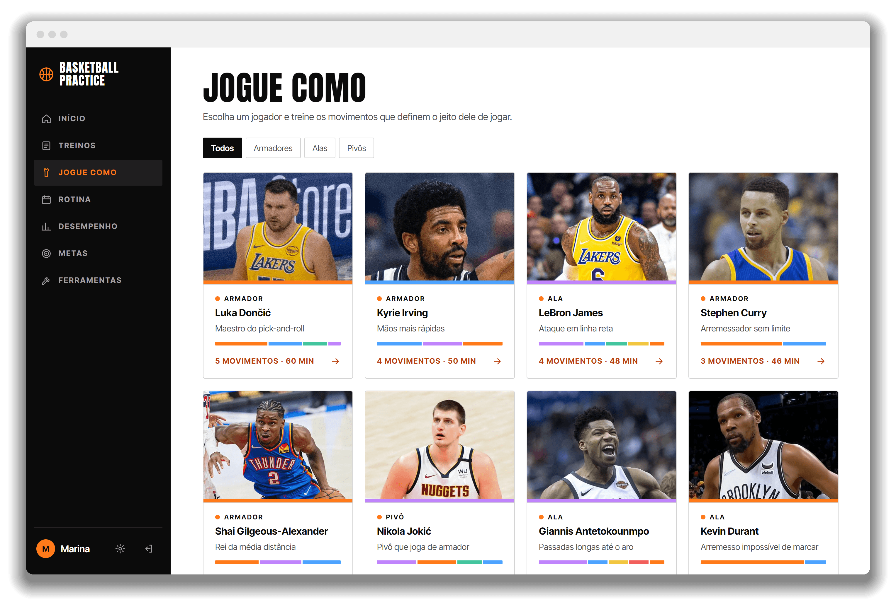</td>
    <td>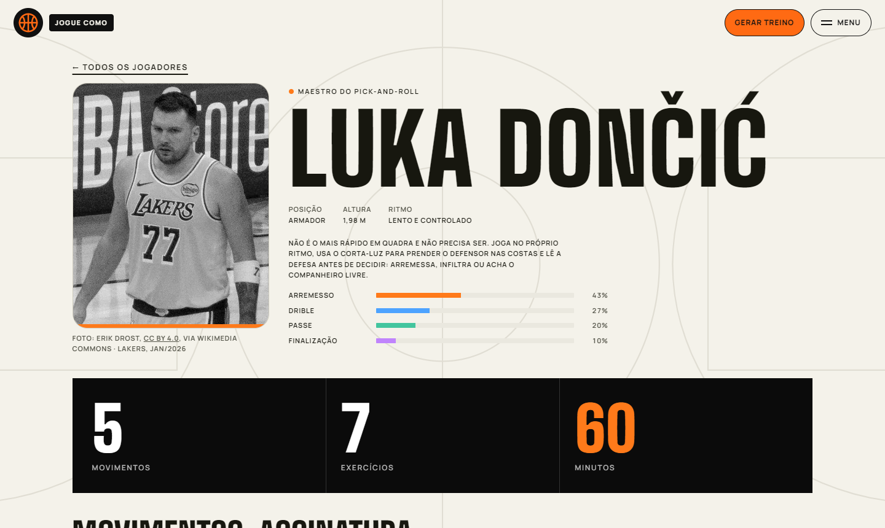</td>
  </tr>
  <tr>
    <td align="center"><b>Jogue Como</b> · 28 Jogadores; O Mouse Revela A Cor Da Foto</td>
    <td align="center"><b>Perfil Do Jogador</b> · Estilo, Movimentos E Treino Pronto</td>
  </tr>
</table>

  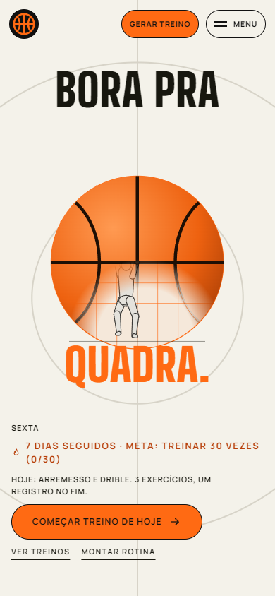
   
  Feito Para Usar Na Quadra, Direto Do Celular.

---

  Projeto Pessoal, Não É Open Source: Todos Os Direitos Reservados.
   
  Feito Com 🧡 E Muitos Arremessos Por <a href="https://github.com/EduardoLafaiety">Eduardo Lopes</a>.

