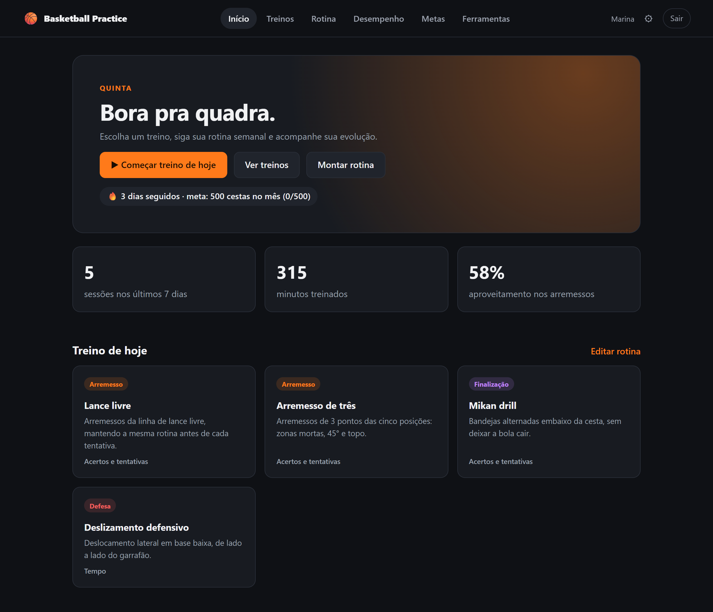
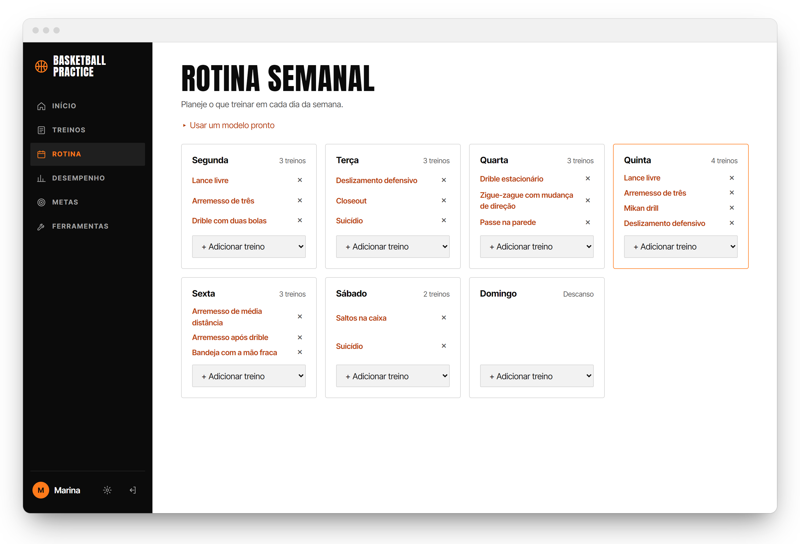
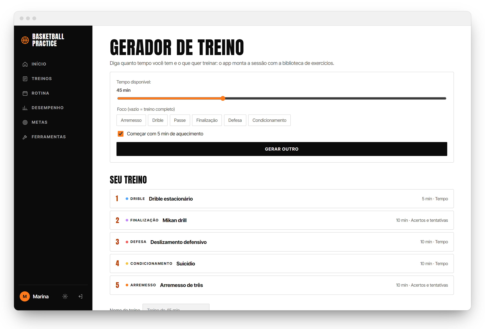
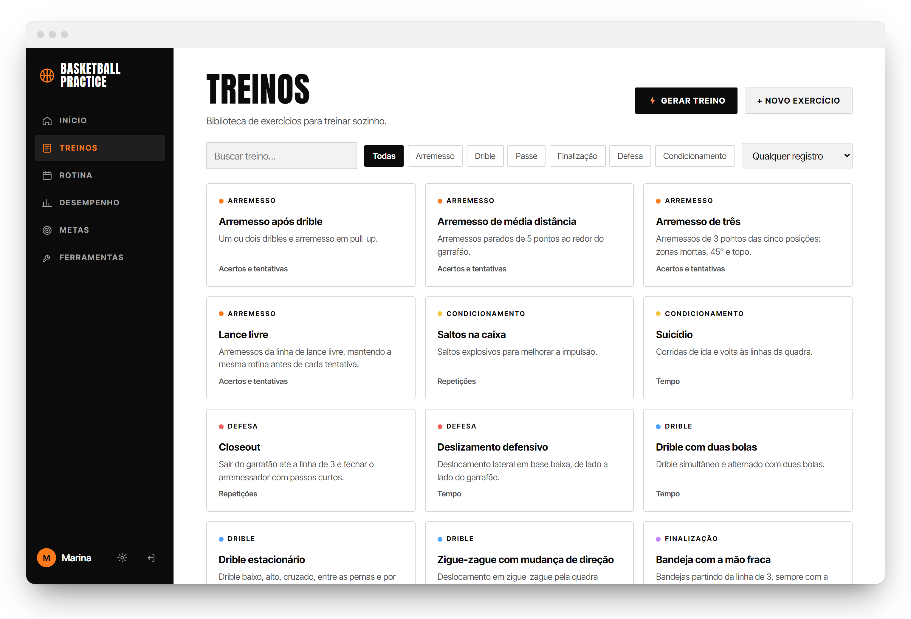
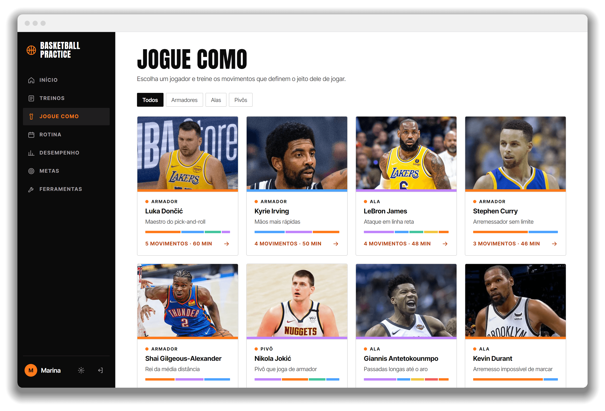
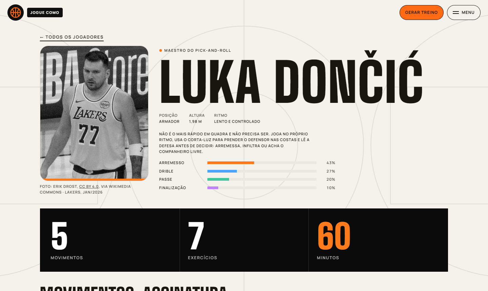
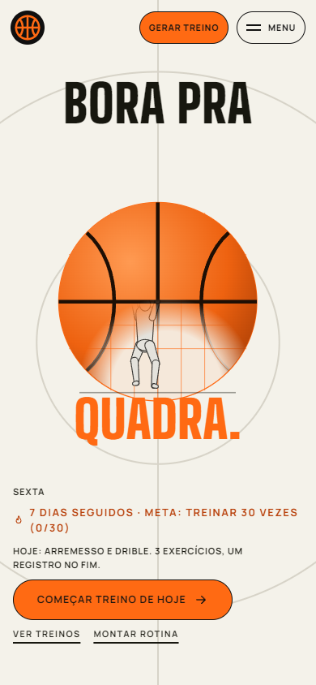

<div align="center">


# Basketball Practice

**Do Primeiro Quique À Jogada De Decisão: Treinos Em Três Níveis, Figuras Animadas Para Cada Movimento E Sua Evolução Em Números.**


**[▶ Experimente A Demonstração](https://eduardolafaiety.github.io/BasketballPractice/)**: Entre Com Qualquer E-Mail E Senha Ou Sem Conta, Direto No Navegador.

<br />



</div>

---

## ✨ O Que Tem.

- 📶 **Três Níveis**: Iniciante, Intermediário E Avançado, Com 50 Exercícios Em Cada Um E Aquecimento Próprio.
- 🎬 **Como Fazer**: Os 181 Exercícios Do Catálogo Têm Uma Animação De Um Manequim Mostrando O Movimento.
- ⚡ **Gerador De Treino**: Diga Quanto Tempo Tem, O Nível E O Foco, E A Sessão Sai Pronta.
- 🌟 **Jogue Como**: Escolha Um Entre 28 Jogadores Da NBA E Treine Os Movimentos Que Definem O Estilo Dele.
- ▶️ **Sessão Guiada**: Animação Ao Lado Do Cronômetro, Contador De Acertos E Registro Automático No Fim.
- 🗓️ **Rotina Semanal**: Gere A Semana Inteira Pelo Tempo, Nível E Foco, Ou Monte O Que Treinar Em Cada Dia.
- 📅 **Programas De 30 Dias**: Um Treino Liberado Por Dia, Com Barra De Progresso.
- 🏀 **Visual De Quadra**: A Bola Da Abertura Amplia Sem Perder Nitidez Ao Rolar A Página, E Uma Listra Com As Costuras Dela Abre As Seções De Números E Ferramentas.
- 📱 **PWA**: Instalável No Celular, Com Tema Claro/Escuro E Lembretes De Treino, Inclusive Com O App Fechado (Web Push).

## 📸 Telas

<table>
  <tr>
    <td></td>
    <td></td>
  </tr>
  <tr>
    <td align="center"><b>Rotina Semanal</b> · O Dia De Hoje Em Destaque</td>
    <td align="center"><b>Gerador</b> · Um Treino Completo Em Um Clique</td>
  </tr>
  <tr>
    <td></td>
    <td></td>
  </tr>
  <tr>
    <td align="center"><b>Treinos</b> · Três Níveis, Com O Aquecimento Primeiro</td>
    <td></td>
  </tr>
  <tr>
    <td></td>
    <td></td>
  </tr>
  <tr>
    <td align="center"><b>Jogue Como</b> · 28 Jogadores; O Mouse Revela A Cor Da Foto</td>
    <td align="center"><b>Perfil Do Jogador</b> · Estilo, Movimentos E Treino Pronto</td>
  </tr>
</table>

<div align="center">
  
  <br />
  <sub>Feito Para Usar Na Quadra, Direto Do Celular.</sub>
</div>

---

<div align="center">
  <sub>Projeto Pessoal, Não É Open Source: Todos Os Direitos Reservados.</sub>
  <br />
  <sub>Feito Com 🧡 E Muitos Arremessos Por <a href="https://github.com/EduardoLafaiety">Eduardo Lopes</a>.</sub>
</div>


## Desenvolvimento

Documentação do projeto: [arquitetura](ARQUITETURA.md), [regras de negócio](REGRAS_DE_NEGOCIO.md), [mudanças e roadmap](MUDANCAS_E_ROADMAP.md) e [plano de refatoração](PLANO_DE_REFATORACAO.md).

Requisitos: Node.js 22.13 ou superior (CI e deploy usam Node 22), npm, Docker para o Postgres local e Google Chrome para os testes de ponta a ponta.

Instale as dependências em cada pacote, a partir da raiz:

```powershell
npm --prefix backend ci
npm --prefix frontend ci
npm --prefix e2e ci
Copy-Item backend/.env.example backend/.env
npm --prefix backend run db:up
```

Em dois terminais, execute `npm --prefix backend run dev` e `npm --prefix frontend run dev`. Abra http://localhost:5173; a API atende em http://localhost:3333/api e o Vite encaminha /api para ela. O banco local usa a porta 5433. Migrações e catálogo são aplicados ao iniciar a API. Em desenvolvimento, EMAIL_PROVIDER=console mostra no terminal os links de ativação e recuperação de conta. Não versione o .env.

### Demonstração e produção

- Demonstração: `npm --prefix frontend run dev:demo` ou `npm --prefix frontend run build:demo`. As rotas do backend rodam no navegador sobre PGlite/IndexedDB; o token de visitante não autentica na API real. A preparação de dev:demo tenta atualizar o NBB pela rede.
- Produção: `npm --prefix backend run build`, `npm --prefix backend start` e `npm --prefix frontend run build`. Configure DATABASE_URL, JWT_SECRET, CORS_ORIGIN, APP_URL e o provedor de e-mail conforme backend/.env.example. VITE_API_URL aponta para a API quando estiver em outro domínio. Configure no host do frontend o fallback das rotas para index.html.
- O arquivo render.yaml descreve a API; os comentários nele documentam os serviços externos esperados. Chaves VAPID habilitam Web Push. O agendador externo usa PUSH_CRON_SECRET.

### Treinos recuperáveis e sincronização

A sessão guiada guarda um rascunho por conta neste navegador, incluindo contadores, blocos e diário. Ao reabrir /sessao, é possível retomar com o relógio pausado ou descartar o rascunho. Os segundos transcorridos são calculados por timestamps, inclusive após suspensão de execução da aba.

Se o envio falhar por rede ou erro 5xx, a sessão fica na fila local. Com a conta autenticada, o app tenta enviar ao abrir, ao recuperar conexão, a cada 30 segundos e pelo botão Sincronizar agora. A sessão carrega uma chave UUID estável: repetir o envio retorna a mesma sessão. A fila atual mantém itens independentes e lê o formato anterior. A conclusão do dia de programa participa da mesma transação da sessão; rejeitar o dia desfaz o registro inteiro. Erros de validação e conflitos de programa exigem correção e aparecem na interface.

A fila e o rascunho são locais ao aparelho, sem backup automático. Sair explicitamente da conta limpa esses dados; sincronize antes de sair. Token expirado preserva os dados locais para retomar após entrar na mesma conta. Limpar os dados do navegador também remove os treinos ainda não enviados. O service worker guarda somente os arquivos do app: para reabrir sem conexão, visite /sessao online ao menos uma vez. O catálogo completo da API não fica disponível offline.

### Validação

```powershell
npm --prefix backend run typecheck
npm --prefix backend test
npm --prefix frontend test
npm --prefix frontend run build
npm --prefix frontend run build:demo
npm --prefix e2e test
```

Os testes da API usam PGlite; os testes ponta a ponta usam Postgres real, um banco exclusivo basketball_e2e (ou E2E_DATABASE_URL), a API na porta 3410 e o site na 4410. O banco de E2E é recriado: nunca aponte essa variável para dados pessoais ou produção. A integração contínua executa testes, build de produção e build da demonstração.

### Organização

- backend/src/modules: endpoints, schemas, serviços e persistência por domínio; backend/src/db: conexão, migrações e catálogo.
- frontend/src/app: composição e layout; features: telas, modelos e testes por funcionalidade; shared: API, cache, tipos e componentes reutilizáveis.
- frontend/src/features/sessao/model/treino-local.ts: rascunhos e fila por conta; frontend/src/shared/lib/relogio.ts: cálculo do tempo.
- frontend/src/styles.css importa os estilos por área na ordem histórica da cascata. Os ajustes de navegação e evolução ficam em styles/navegacao.css; pixel.css continua aplicado depois.

Evolução compara os últimos 7 ou 30 dias locais, incluindo hoje, com a janela imediatamente anterior. O filtro por exercício compara sessões, arremessos, repetições e segundos registrados. Os minutos aparecem somente no total: não há duração individual confiável para todos os exercícios. Overall é uma pontuação dos registros, não uma medida validada da habilidade real.


### Comandos da raiz e auditoria

A raiz oferece atalhos como `npm run check:architecture`, `npm run test:site` e `npm run test:api`, sem mudar a instalação das dependências em cada pacote. Consulte [ARQUITETURA.md](ARQUITETURA.md) para as fronteiras dos módulos.

`npm --prefix e2e run audit` captura Início, Treinos, Rotina, Sessão e Evolução em dois tamanhos e nos temas claro/escuro. Capturas e contagens de recursos vão para o diretório temporário do sistema. A auditoria utiliza o banco E2E e deve rodar separada da suíte ponta a ponta.

A rotina preserva o tempo planejado de cada exercício. Aplicar a semana gerada usa uma transação no servidor atual; a compatibilidade com servidores anteriores mantém o envio por dia. A comparação em Evolução busca agregados na API; Overall e conquistas ainda consultam o histórico completo.
