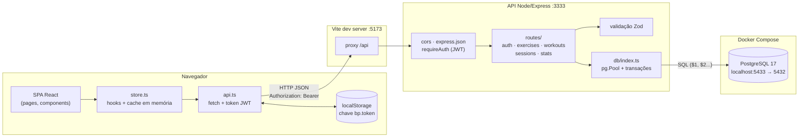
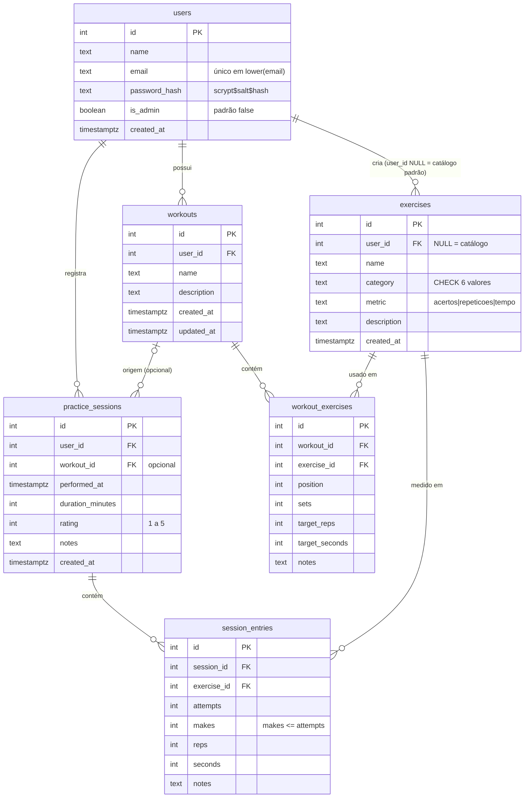

# Basketball Practice — Documentação técnica

> Documento escrito em 2026-10-23 a partir do código do repositório. Quando algo aqui divergir do código, vale o código.

## Índice

1. [Visão geral](#1-visão-geral)
   - [Arquitetura](#arquitetura)
   - [Fluxo de uma requisição](#fluxo-de-uma-requisição)
2. [Ferramentas e bibliotecas](#2-ferramentas-e-bibliotecas)
   - [Frontend](#frontend)
   - [Backend](#backend)
   - [Banco de dados e infraestrutura](#banco-de-dados-e-infraestrutura)
   - [Testes](#testes)
3. [Conceitos usados](#3-conceitos-usados)
4. [Estrutura de pastas](#4-estrutura-de-pastas)
5. [API REST](#5-api-rest)
6. [Modelo de dados](#6-modelo-de-dados)
7. [Como o frontend usa a API](#7-como-o-frontend-usa-a-api)
8. [Como rodar](#8-como-rodar)
9. [Decisões e estado atual](#9-decisões-e-estado-atual)

---

## 1. Visão geral

O **Basketball Practice** é um app web para **um atleta individual** de basquete organizar e acompanhar o próprio treino. Ele tem três partes:

| Área | O que faz | Onde está |
| --- | --- | --- |
| **Treinos** | Biblioteca dividida em iniciante, intermediário e avançado, cada nível com seu aquecimento em ordem de progressão. Exercícios (arremesso, drible, passe, finalização, defesa, condicionamento), com cronômetro e registro de sessão | [Treinos.tsx](../frontend/src/pages/Treinos.tsx), [TreinoDetalhe.tsx](../frontend/src/pages/TreinoDetalhe.tsx) |
| **Rotina** | Plano semanal: quais exercícios fazer em cada dia | [Rotina.tsx](../frontend/src/pages/Rotina.tsx) |
| **Desempenho** | Totais de sessões, minutos, aproveitamento nos arremessos, gráfico dos últimos 7 dias e histórico | [Desempenho.tsx](../frontend/src/pages/Desempenho.tsx), [Inicio.tsx](../frontend/src/pages/Inicio.tsx) |

O MVP começou pelos **treinos** (catálogo + registro de sessão); rotina e desempenho foram construídos em cima disso. O usuário precisa criar uma conta e entrar ([Entrar.tsx](../frontend/src/pages/Entrar.tsx)), e cada atleta só enxerga os próprios dados.

O projeto tem duas aplicações independentes:

- **`frontend/`** — SPA em React 18 + TypeScript, gerada pelo Vite.
- **`backend/`** — API REST em Node.js + Express 5 + TypeScript, que guarda os dados no PostgreSQL.

### Arquitetura



Versão em texto:

```
Navegador (React SPA)                     Node.js (Express 5)                 Docker
┌──────────────────────────┐   /api/*    ┌───────────────────────────┐  SQL  ┌──────────────────┐
│ pages → store.ts → api.ts│ ──────────► │ cors → json → requireAuth │ ────► │ PostgreSQL 17    │
│ token JWT no localStorage│  (proxy do  │ → routes → Zod → db (pg)  │       │ porta 5433 → 5432│
└──────────────────────────┘   Vite)     └───────────────────────────┘       └──────────────────┘
```

### Fluxo de uma requisição

Exemplo: o atleta salva uma sessão em `TreinoDetalhe`.

1. O formulário chama `adicionar(...)` do hook `useSessoes` — [TreinoDetalhe.tsx:62](../frontend/src/pages/TreinoDetalhe.tsx#L62).
2. O hook chama `api.registrarSessao`, que converte o formato do frontend (`drillId`, `acertos`…) para o do backend (`entries[].exerciseId`, `makes`…) — [api.ts:199](../frontend/src/api.ts#L199).
3. `request()` faz o `fetch` para `/api/sessions` com o cabeçalho `Authorization: Bearer <token>` — [api.ts:45](../frontend/src/api.ts#L45).
4. Em desenvolvimento, o Vite repassa `/api` para `http://localhost:3333` — [vite.config.ts:11](../frontend/vite.config.ts#L11).
5. No Express, `requireAuth` valida o JWT, confere se a conta ainda existe e põe `req.userId` — [middleware/auth.ts:13](../backend/src/middleware/auth.ts#L13).
6. A rota valida o corpo com Zod, confere se os exercícios são visíveis ao usuário e grava sessão + entradas numa **transação** — [routes/sessions.ts:159](../backend/src/routes/sessions.ts#L159).
7. A resposta volta em JSON; o `store.ts` atualiza o cache e a tela navega para `/desempenho`.

---

## 2. Ferramentas e bibliotecas

As versões vêm de [frontend/package.json](../frontend/package.json) e [backend/package.json](../backend/package.json). Os motivos de escolha refletem as necessidades do projeto: app pequeno, um desenvolvedor, um usuário por conta, pouca configuração.

### Frontend

#### React 18 (`react`, `react-dom` ^18.3.1)
- **O que é:** biblioteca para montar interfaces com componentes e estado.
- **No projeto:** todas as telas e componentes; a raiz é criada em [main.tsx:8](../frontend/src/main.tsx#L8) com `createRoot` e `StrictMode`.
- **Por que:** é o ecossistema mais conhecido, com hooks que bastam para o estado do app (sem Redux) e muita documentação.
- **Alternativas descartadas:** Vue/Svelte (menos familiares para manutenção futura e com ecossistema menor de exemplos); Angular (pesado demais para um app deste tamanho).

#### Vite (^5.4.11) + `@vitejs/plugin-react`
- **O que é:** ferramenta de build e servidor de desenvolvimento com recarga instantânea (HMR).
- **No projeto:** `npm run dev` / `build` / `preview`; também faz o **proxy** de `/api` para o backend — [vite.config.ts](../frontend/vite.config.ts).
- **Por que:** sobe em milissegundos, já entende TypeScript e JSX, e o proxy evita configurar CORS em desenvolvimento.
- **Alternativas descartadas:** **Create React App** (descontinuado e lento); **Next.js** (traz renderização no servidor e roteamento por arquivos, que não são necessários: o backend já é separado e o app é todo atrás de login, sem necessidade de SEO).

#### TypeScript (~5.6.3)
- **O que é:** JavaScript com tipos verificados na compilação.
- **No projeto:** frontend e backend inteiros. Modo `strict` ligado nos dois `tsconfig.json` ([frontend](../frontend/tsconfig.json), [backend](../backend/tsconfig.json)). Os tipos do domínio estão em [types.ts](../frontend/src/types.ts) e os contratos da API em [api.ts:78](../frontend/src/api.ts#L78).
- **Por que:** pega erros de formato de dados (ex.: campo da API renomeado) antes de rodar, e a mesma linguagem nos dois lados.
- **Alternativas descartadas:** JavaScript puro (sem segurança de tipos entre frontend e API).

#### react-router-dom (^6.28.0)
- **O que é:** roteamento no cliente para React.
- **No projeto:** `BrowserRouter` em [main.tsx:10](../frontend/src/main.tsx#L10); rotas em [App.tsx](../frontend/src/App.tsx); rota protegida `RequerLogin` em [auth.tsx:74](../frontend/src/auth.tsx#L74); menu com `NavLink` em [Layout.tsx](../frontend/src/components/Layout.tsx).
- **Por que:** padrão de fato para SPA em React, suporta rotas aninhadas com layout (`<Outlet />`) e parâmetros (`/treinos/:id`).
- **Alternativas descartadas:** TanStack Router (mais novo, mais configuração); roteamento manual com `window.location` (reinventar a roda).

#### CSS puro
- **O que é:** um único arquivo CSS com variáveis (custom properties), sem framework.
- **No projeto:** [styles.css](../frontend/src/styles.css): cores em variáveis no `:root` ([styles.css:1](../frontend/src/styles.css#L1)), tema claro automático com `prefers-color-scheme` ([styles.css:25](../frontend/src/styles.css#L25)), layout responsivo com `grid` e `@media (max-width: 800px)` ([styles.css:320](../frontend/src/styles.css#L320)), cor por categoria (`.tag-Arremesso` etc., [styles.css:232](../frontend/src/styles.css#L232)).
- **Por que:** zero dependência e zero etapa de build extra; o app tem poucas telas e um visual próprio, então um arquivo resolve.
- **Alternativas descartadas:** **Tailwind** (exige configuração e deixa o JSX carregado de classes); CSS-in-JS como styled-components (custo em tempo de execução); bibliotecas de componentes como MUI (visual genérico e pacote pesado).

#### localStorage
- **O que é:** armazenamento chave-valor do navegador que persiste entre visitas.
- **No projeto:** guarda **apenas o token JWT**, na chave `bp.token` — [api.ts:5](../frontend/src/api.ts#L5) e [api.ts:30](../frontend/src/api.ts#L30). Os dados de treino ficam no PostgreSQL; no navegador eles só existem num cache em memória ([store.ts:7](../frontend/src/store.ts#L7)), limpo no logout.
- **Por que:** mantém o usuário logado ao recarregar a página, sem cookies nem servidor de sessão. As leituras/escritas estão em `try/catch` para funcionar mesmo se o armazenamento estiver bloqueado.
- **Alternativas descartadas:** cookie `httpOnly` (mais protegido contra XSS, mas exige configurar cookies e CSRF entre domínios); `sessionStorage` (perde o login ao fechar a aba).

### Backend

#### Node.js 24
- **O que é:** ambiente para rodar JavaScript/TypeScript no servidor.
- **No projeto:** `engines` pede `>=22.13` e o README diz "testado no 24" ([backend/package.json:6](../backend/package.json#L6)). Usa recursos nativos recentes: `process.loadEnvFile()` para ler o `.env` ([config.ts:2](../backend/src/config.ts#L2)), `node:crypto` (scrypt), `node:test` e `fetch` global nos testes, `await` no topo do módulo ([server.ts:5](../backend/src/server.ts#L5)).
- **Por que:** mesma linguagem do frontend; as versões novas já trazem leitura de `.env`, runner de testes e `fetch`, o que elimina dependências como `dotenv`, Jest e `node-fetch`.
- **Alternativas descartadas:** Deno/Bun (menos maduros com o ecossistema `pg`/Express); Python/Java (segunda linguagem no projeto).

#### Express 5 (^5.1.0)
- **O que é:** framework HTTP minimalista para Node.
- **No projeto:** montagem do app em [app.ts](../backend/src/app.ts); um `Router` por recurso em [routes/](../backend/src/routes/).
- **Por que:** simples e conhecido. A versão 5 **repassa automaticamente erros de handlers `async`** para o middleware de erro, então as rotas só fazem `throw new HttpError(...)` sem `try/catch` (ex.: [routes/auth.ts:58](../backend/src/routes/auth.ts#L58)).
- **Alternativas descartadas:** **Fastify** (mais rápido, mas o ganho não importa nesta escala e o modelo de plugins é mais trabalhoso); **NestJS** (decorators, injeção de dependência e módulos são estrutura demais para cinco recursos); Express 4 (precisaria de wrapper para erros async).

#### cors (^2.8.5)
- **O que é:** middleware que responde aos cabeçalhos CORS.
- **No projeto:** libera só a origem de `CORS_ORIGIN` (padrão `http://localhost:5173`) — [app.ts:17](../backend/src/app.ts#L17).
- **Por que:** em produção o site e a API podem estar em domínios diferentes (`VITE_API_URL`, ver [frontend/.env.example](../frontend/.env.example)). Em dev o proxy do Vite torna isso desnecessário.

#### Zod (^4.6.7)
- **O que é:** biblioteca de validação por esquema com inferência de tipos TypeScript.
- **No projeto:** cada rota declara o esquema do corpo/query (ex.: `sessionSchema` em [routes/sessions.ts:25](../backend/src/routes/sessions.ts#L25)); o helper `parse()` transforma falhas em HTTP 400 com os erros por campo — [lib/validate.ts:4](../backend/src/lib/validate.ts#L4). Também normaliza dados (`trim`, `toLowerCase` no e-mail, `z.coerce` em query strings, `.default([])`).
- **Por que:** um único esquema serve de validação **e** de tipo (`z.infer`), sem duplicar interfaces.
- **Alternativas descartadas:** **Joi** (não gera tipos TypeScript a partir do esquema); class-validator (exige classes e decorators); validação manual (verbosa e fácil de esquecer um campo).

#### JWT — `jsonwebtoken` (^9.0.2)
- **O que é:** JSON Web Token, um token assinado que carrega o id do usuário.
- **No projeto:** `signToken` cria o token com `sub = userId` e validade `JWT_EXPIRES_IN` (padrão `7d`); `verifyToken` confere assinatura e expiração — [lib/token.ts](../backend/src/lib/token.ts). Em produção a API se recusa a subir com o segredo padrão — [config.ts:10](../backend/src/config.ts#L10).
- **Por que:** autenticação **stateless**: a API não guarda sessões, basta o segredo para validar. Funciona igual com o proxy em dev e com domínios separados em produção.
- **Alternativas descartadas:** **sessões no servidor** (`express-session` + tabela ou Redis: mais infraestrutura e cookies cross-domain); provedores externos como Auth0/Firebase (dependência paga/externa para um app de um usuário). Ponto conhecido: não há revogação de token antes de expirar.

#### Hash de senha — `scrypt` do `node:crypto`
- **O que é:** função de derivação de chave lenta e que consome memória, feita para dificultar ataques de força bruta.
- **No projeto:** [lib/password.ts](../backend/src/lib/password.ts) gera salt aleatório de 16 bytes, hash de 64 bytes e salva no formato `scrypt$<salt>$<hash>`; a comparação usa `timingSafeEqual` para não vazar informação pelo tempo de resposta.
- **Por que:** já vem no Node, sem dependência nativa para compilar; o prefixo `scrypt$` permite trocar de algoritmo no futuro.
- **Alternativas descartadas:** `bcrypt` (módulo nativo que às vezes falha ao instalar no Windows); `argon2` (também nativo); SHA-256 simples (rápido demais, inseguro para senhas).

#### pg (^8.23.1)
- **O que é:** driver oficial de PostgreSQL para Node.
- **No projeto:** um `pg.Pool` com fuso UTC forçado — [db/index.ts:68](../backend/src/db/index.ts#L68). O pool é embrulhado na interface própria `Database` (`query`, `transaction`, `close`) — [db/index.ts:8](../backend/src/db/index.ts#L8) — com helpers `one()` e `many()`. Todo SQL usa parâmetros `$1, $2…`. O pool tem 10 conexões fixas, abertas antes de a API atender, e só descarta uma conexão que caiu, não por um erro de SQL: abrir conexão é caro e, com a máquina ocupada, chega ao limite de 5 s.
- **Por que:** SQL escrito à mão dá controle total (ex.: `unnest ... WITH ORDINALITY` para inserir várias linhas de uma vez em [routes/sessions.ts:118](../backend/src/routes/sessions.ts#L118), agregados por semana em [routes/stats.ts:40](../backend/src/routes/stats.ts#L40)) e a interface `Database` permite trocar o banco por PGlite nos testes.
- **Alternativas descartadas:** **ORMs** como Prisma/TypeORM/Sequelize (geração de código, migrações próprias e abstrações que escondem o SQL; não funcionariam tão facilmente com PGlite); query builders como Knex/Kysely (mais uma camada para seis tabelas).

#### tsx (^4.19.2)
- **O que é:** executa TypeScript direto no Node, sem compilar antes.
- **No projeto:** `npm run dev` (`tsx watch`, reinicia ao salvar) e `npm test` (`tsx --test`) — [backend/package.json:10](../backend/package.json#L10). Para produção, `tsc` compila para `dist/`.
- **Por que:** rápido (usa esbuild) e sem configuração.
- **Alternativas descartadas:** `ts-node` (mais lento e chato com ESM); `nodemon` + `tsc --watch` (dois processos).

#### Pacotes `@types/*`
`@types/react`, `@types/react-dom`, `@types/express`, `@types/cors`, `@types/jsonwebtoken`, `@types/pg`, `@types/node`: só tipos para o TypeScript, sem código em tempo de execução.

### Banco de dados e infraestrutura

#### PostgreSQL 17 (imagem `postgres:17-alpine`)
- **O que é:** banco de dados relacional.
- **No projeto:** seis tabelas de domínio + `schema_migrations` ([seção 6](#6-modelo-de-dados)). Usa recursos próprios do Postgres: `GENERATED ... AS IDENTITY`, `timestamptz`, índice único em `lower(email)`, `CHECK`, `pg_advisory_xact_lock`, `date_trunc('week', ...)`, `ANY($1::int[])`, `unnest`.
- **Por que:** **escolha do usuário**, substituindo o SQLite. Dá integridade forte (chaves estrangeiras, `CHECK`), funciona com várias instâncias da API e é o mesmo banco do desenvolvimento à produção.
- **Alternativas descartadas:** SQLite (era a opção anterior; ver [seção 9](#9-decisões-e-estado-atual)); MySQL; bancos de documentos como MongoDB (os dados são claramente relacionais: sessão → entradas → exercício).

#### Docker Compose
- **O que é:** sobe containers descritos num arquivo YAML.
- **No projeto:** [docker-compose.yml](../backend/docker-compose.yml) com um serviço `postgres`: usuário/senha/banco `basketball`, fuso `UTC`, porta **`${POSTGRES_PORT:-5433}:5432`**, volume nomeado `postgres-data` e `healthcheck` com `pg_isready` (usado por `docker compose up --wait` no script `db:up`).
- **Por que:** o banco de desenvolvimento sobe com um comando, igual em qualquer máquina, sem instalar nem mexer no Postgres local.
- **Alternativas descartadas:** usar o Postgres nativo da máquina (já existe um na 5432 e não deve ser alterado); banco gerenciado na nuvem para dev (precisa de internet e conta).

### Testes

#### `node:test` + `node:assert` (nativos) executados pelo `tsx`
- **O que é:** o executor de testes que vem com o Node.
- **No projeto:** [test/api.test.ts](../backend/test/api.test.ts) sobe o app numa porta aleatória (`listen(0)`) e faz chamadas HTTP reais com `fetch`.
- **Por que:** sem dependência extra e roda TypeScript via `tsx --test`.
- **Alternativas descartadas:** Jest (configuração pesada para TS + ESM); Vitest (ótimo, mas mais uma dependência quando o nativo resolve); Supertest (o `fetch` nativo já basta).

#### PGlite (`@electric-sql/pglite` ^0.5.11)
- **O que é:** o PostgreSQL de verdade compilado para WebAssembly, rodando **em memória** dentro do processo Node.
- **No projeto:** [test/pglite.ts](../backend/test/pglite.ts) adapta o PGlite para a mesma interface `Database` do `pg` e aplica as mesmas migrações e seed.
- **Por que:** os testes rodam sem Docker e sem servidor, em segundos, começam sempre com um banco limpo e usam o **mesmo dialeto SQL** da produção.
- **Alternativas descartadas:** Postgres real no Docker para testes (mais lento, exige Docker ligado e limpeza entre execuções); Testcontainers (idem); SQLite em memória (dialeto diferente: as queries com `ANY`, `unnest`, `date_trunc` não funcionariam); mocks do banco (não testam o SQL).

#### Vitest + Testing Library + jsdom (frontend)
- **O que é:** o Vitest roda os testes usando a mesma configuração do Vite; o jsdom simula o navegador no Node; a Testing Library monta os componentes e interage com eles como um usuário (pelo texto, papel e rótulo dos elementos).
- **No projeto:** a configuração fica no bloco `test` de [vite.config.ts](../frontend/vite.config.ts), com fuso fixo em `America/Sao_Paulo` para as contas de data darem o mesmo resultado em qualquer máquina. [src/test/api-falsa.ts](../frontend/src/test/api-falsa.ts) troca o `fetch` por uma API em memória, com rotas no formato `"GET /auth/me"`, e registra cada chamada para o teste conferir o corpo e o token enviados. [src/test/renderizar.tsx](../frontend/src/test/renderizar.tsx) monta o app inteiro (rotas e login) a partir de uma rota.
- **Por que:** o Vitest entende TypeScript, JSX e os imports do Vite sem configuração extra. Simular só o `fetch` deixa o código real do app rodar inteiro: `api.ts`, `store.ts`, `auth.tsx` e as páginas.
- **Alternativas descartadas:** Jest (precisaria de Babel ou ts-jest para TS + ESM); Enzyme (abandonado e preso ao React antigo); MSW para simular a API (mais uma dependência quando um `fetch` falso de 40 linhas resolve).

---

## 3. Conceitos usados

| Conceito | Explicação simples | Onde aparece |
| --- | --- | --- |
| **SPA (Single Page Application)** | O navegador carrega um único HTML; depois o JavaScript troca o conteúdo da tela sem recarregar a página. | [index.html:10](../frontend/index.html#L10) (`<div id="root">`), [main.tsx:8](../frontend/src/main.tsx#L8) |
| **Roteamento no cliente** | A URL muda (`/treinos`, `/rotina`) e o React escolhe qual componente mostrar, sem pedir uma página nova ao servidor. Rotas aninhadas compartilham o layout. | [App.tsx:13](../frontend/src/App.tsx#L13), `<Outlet />` em [Layout.tsx:33](../frontend/src/components/Layout.tsx#L33) |
| **Rota protegida** | Se não há usuário nem token, redireciona para `/entrar` e guarda a página de origem para voltar depois do login. | [auth.tsx:74](../frontend/src/auth.tsx#L74), [Entrar.tsx:11](../frontend/src/pages/Entrar.tsx#L11) |
| **Componentes** | Funções que recebem dados (props) e devolvem a interface; reaproveitáveis. | [DrillCard.tsx](../frontend/src/components/DrillCard.tsx), [Estado.tsx](../frontend/src/components/Estado.tsx) |
| **Estado local** | Valores que mudam e redesenham a tela (`useState`), ex.: cronômetro e campos do formulário. | [TreinoDetalhe.tsx:19](../frontend/src/pages/TreinoDetalhe.tsx#L19), timer com `useEffect` em [TreinoDetalhe.tsx:30](../frontend/src/pages/TreinoDetalhe.tsx#L30) |
| **Estado global via Context** | Dados que várias telas precisam (usuário logado) ficam num `Context` e são lidos com um hook. | `AuthProvider` em [auth.tsx:18](../frontend/src/auth.tsx#L18), `useAuth` em [auth.tsx:67](../frontend/src/auth.tsx#L67) |
| **Hooks customizados + cache** | `useRecurso` busca um recurso, mostra o valor em cache na hora e recarrega em segundo plano (*stale-while-revalidate*). | [store.ts:15](../frontend/src/store.ts#L15); `useDrills`, `useSessoes`, `useResumo`, `useRotina` logo abaixo |
| **Atualização otimista** | A tela muda antes da resposta do servidor; se der erro, desfaz. | remover sessão em [store.ts:78](../frontend/src/store.ts#L78); rotina em [store.ts:113](../frontend/src/store.ts#L113) (com fila para não duplicar salvamentos, [store.ts:107](../frontend/src/store.ts#L107)) |
| **Estados de carregamento e erro** | Cada tela mostra "carregando", "erro + tentar de novo" ou "dados desatualizados". | [Estado.tsx](../frontend/src/components/Estado.tsx) |
| **API REST** | O backend expõe recursos (exercícios, treinos, sessões) em URLs, e o verbo HTTP diz a ação: `GET` lê, `POST` cria, `PUT` substitui, `DELETE` apaga. Respostas em JSON e códigos HTTP com significado (201, 204, 400, 401, 403, 404, 409, 503). | [app.ts:29](../backend/src/app.ts#L29), [routes/](../backend/src/routes/) |
| **Proxy de desenvolvimento** | O Vite recebe `/api/...` e repassa ao backend, então o navegador acha que é tudo do mesmo endereço (sem CORS em dev). | [vite.config.ts:10](../frontend/vite.config.ts#L10) |
| **CORS** | Regra do navegador que bloqueia chamadas entre domínios diferentes; o backend libera só a origem configurada. | [app.ts:17](../backend/src/app.ts#L17) |
| **Middleware** | Funções que rodam em sequência antes/depois das rotas: CORS, leitura do JSON (limite 100 kB), autenticação, 404 e tratamento de erros. | [app.ts:16](../backend/src/app.ts#L16), [middleware/auth.ts](../backend/src/middleware/auth.ts), [middleware/errors.ts](../backend/src/middleware/errors.ts) |
| **Tratamento central de erros** | As rotas lançam `HttpError(status, mensagem)`; um middleware único transforma isso em `{ error, details }`. Erros inesperados viram 500 sem vazar detalhes. | [lib/http-error.ts](../backend/src/lib/http-error.ts), [middleware/errors.ts:8](../backend/src/middleware/errors.ts#L8) |
| **Validação de esquema** | Descreve o formato esperado (tipos, tamanhos, faixas) e rejeita o que não bate antes de tocar no banco. | [lib/validate.ts](../backend/src/lib/validate.ts), regra "acertos ≤ tentativas" em [routes/sessions.ts:20](../backend/src/routes/sessions.ts#L20) |
| **Autenticação stateless (JWT)** | No login o servidor devolve um token assinado; o cliente o envia em todo pedido (`Authorization: Bearer`). O servidor só verifica a assinatura, sem guardar sessão. | criação em [lib/token.ts:4](../backend/src/lib/token.ts#L4), verificação em [middleware/auth.ts:13](../backend/src/middleware/auth.ts#L13), envio em [api.ts:52](../frontend/src/api.ts#L52), logout automático ao receber 401 em [api.ts:70](../frontend/src/api.ts#L70) |
| **Hash de senha com salt** | A senha nunca é salva; guarda-se um resumo irreversível com um valor aleatório (salt) por usuário. | [lib/password.ts](../backend/src/lib/password.ts) |
| **Isolamento por usuário** | Toda consulta filtra por `user_id`; o catálogo padrão tem `user_id NULL` e é visível a todos, mas não pode ser alterado (403). | [routes/exercises.ts:34](../backend/src/routes/exercises.ts#L34), [routes/exercises.ts:63](../backend/src/routes/exercises.ts#L63); teste em [api.test.ts:119](../backend/test/api.test.ts#L119) |
| **Variáveis de ambiente** | Configurações que mudam por máquina (porta, segredo, URL do banco) ficam fora do código, num `.env` que não vai para o git. | [config.ts](../backend/src/config.ts), [backend/.env.example](../backend/.env.example), [frontend/.env.example](../frontend/.env.example), [vite-env.d.ts](../frontend/src/vite-env.d.ts) |
| **Pool de conexões** | Um conjunto de conexões abertas com o banco reaproveitadas entre requisições. | [db/index.ts:68](../backend/src/db/index.ts#L68) |
| **Consultas parametrizadas** | Valores vão separados do SQL (`$1`, `$2`), o que impede SQL injection. | todas as rotas, ex.: [routes/auth.ts:38](../backend/src/routes/auth.ts#L38) |
| **Transações** | Várias operações que acontecem "tudo ou nada" (`BEGIN`/`COMMIT`/`ROLLBACK`): sessão e suas entradas são gravadas juntas. | [db/index.ts:37](../backend/src/db/index.ts#L37), [routes/sessions.ts:164](../backend/src/routes/sessions.ts#L164) |
| **Migrações / esquema do banco** | O esquema é uma lista versionada de scripts SQL. Ao iniciar, a API aplica só os que faltam e registra a versão em `schema_migrations`. Um *advisory lock* impede duas instâncias de migrarem ao mesmo tempo. Nunca se edita uma migração já aplicada; adiciona-se outra. | [db/migrations.ts:4](../backend/src/db/migrations.ts#L4), [db/migrations.ts:77](../backend/src/db/migrations.ts#L77) |
| **Seed** | Dados iniciais: o catálogo padrão ([catalog.ts](../backend/src/db/catalog.ts)), com pelo menos 50 exercícios e um aquecimento em cada nível (iniciante, intermediário e avançado). Roda a cada início e insere só os que faltam, pelo nome, então um banco antigo recebe os exercícios novos. | [db/seed.ts](../backend/src/db/seed.ts) |
| **Containers** | Um processo isolado com tudo que precisa (aqui, o Postgres), descrito em arquivo e reproduzível. O volume mantém os dados entre reinícios; o healthcheck diz quando está pronto. | [docker-compose.yml](../backend/docker-compose.yml) |
| **Desligamento gracioso** | Ao receber `SIGINT`/`SIGTERM`, o servidor para de aceitar conexões e fecha o pool antes de sair. | [server.ts:10](../backend/src/server.ts#L10) |
| **Injeção de dependência simples** | `createApp(db)` e cada `xxxRouter(db)` recebem o banco como parâmetro, então os testes passam um banco diferente. | [app.ts:13](../backend/src/app.ts#L13) |
| **Testes de integração em memória** | Testam o caminho completo (HTTP → Express → SQL) usando um Postgres em memória (PGlite), sem Docker. | [test/api.test.ts](../backend/test/api.test.ts), [test/pglite.ts](../backend/test/pglite.ts) |
| **Datas em UTC** | Banco, pool e testes usam UTC; o filtro `from`/`to` é inclusivo: `AAAA-MM-DD` vale o dia inteiro em UTC e um ISO com horário vale o instante exato (o frontend manda a meia-noite local). Semanas começam na segunda (ISO 8601). | [db/index.ts:67](../backend/src/db/index.ts#L67), [routes/sessions.ts:46](../backend/src/routes/sessions.ts#L46), [routes/stats.ts:39](../backend/src/routes/stats.ts#L39) |

---

## 4. Estrutura de pastas

```
BasketballPractice/
├── .claude/launch.json          configurações para subir frontend/backend pelo app do Claude
├── docs/
│   └── DOCUMENTACAO.md          este arquivo
├── frontend/                    SPA React
│   ├── index.html               HTML único da SPA
│   ├── vite.config.ts           plugin React + proxy /api
│   ├── tsconfig.json
│   ├── .env.example             VITE_API_URL, API_PROXY
│   └── src/
│       ├── main.tsx             ponto de entrada (StrictMode, BrowserRouter, AuthProvider)
│       ├── App.tsx              tabela de rotas
│       ├── api.ts               cliente HTTP, token, contratos e mapeamento backend → frontend
│       ├── auth.tsx             contexto de login, useAuth, RequerLogin
│       ├── store.ts             hooks de dados com cache compartilhado (drills, sessões, resumo, zonas,
│       │                        progresso, metas, testes, config, rotina) e utilitários
│       ├── types.ts             tipos do domínio (Drill, Sessao, Resumo, Rotina, Meta, Zona…)
│       ├── styles.css           todo o visual (inclui tema claro/escuro forçado por data-theme)
│       ├── vite-env.d.ts        tipos das variáveis VITE_*
│       ├── components/
│       │   ├── Layout.tsx       cabeçalho, menu, tema e agendamento dos lembretes
│       │   ├── DrillCard.tsx    cartão de exercício
│       │   ├── Estado.tsx       Carregando, ErroCarga, AvisoDesatualizado
│       │   ├── Quadra.tsx       meia-quadra em SVG: escolher zona ou mapa de calor
│       │   ├── Contador.tsx     contador ao vivo (acerto/erro, sequência, zona, desfazer)
│       │   ├── GraficoLinha.tsx gráfico de linha em SVG
│       │   ├── BarraProgresso.tsx
│       │   └── FormExercicio.tsx criar/editar exercício próprio
│       ├── ferramentas/         abas da página Ferramentas
│       │   ├── TimerIntervalos.tsx  trabalho/descanso/rodadas com bipes
│       │   ├── Metronomo.tsx        metrônomo de drible (Web Audio) com tap tempo
│       │   ├── LancesLivres.tsx     contador avulso salvo como sessão
│       │   ├── Calculadoras.tsx     FG%, eFG%, TS%, quanto falta para a meta, distâncias
│       │   └── Video.tsx            gravar, câmera lenta, quadro a quadro, comparar
│       ├── lib/
│       │   ├── audio.ts         bipes, vibração e metrônomo agendado no relógio do áudio
│       │   ├── telaLigada.ts    useTelaLigada (Wake Lock API)
│       │   ├── videos.ts        vídeos no IndexedDB (só no navegador)
│       │   ├── lembretes.ts     notificações e cálculo do próximo lembrete
│       │   ├── tema.ts          aplica o tema no <html>
│       │   ├── pwa.ts           registro do service worker e botão "Instalar"
│       │   ├── calculos.ts      fórmulas das calculadoras
│       │   └── arquivo.ts       download de arquivos e CSV de sessões
│       └── pages/
│           ├── Entrar.tsx       login e cadastro
│           ├── Inicio.tsx       resumo dos últimos 7 dias, sequência e treino de hoje
│           ├── Treinos.tsx      catálogo com busca, filtros e criação de exercício
│           ├── JogueComo.tsx    jogadores da NBA com filtro por posição
│           ├── EstiloDetalhe.tsx  movimentos-assinatura e treino do estilo de um jogador
│           ├── TreinoDetalhe.tsx cronômetro, contador ao vivo e registro de sessão
│           ├── Gerador.tsx      gera um treino pelo tempo disponível e foco
│           ├── SessaoGuiada.tsx executa um plano bloco a bloco e salva uma sessão só
│           ├── Rotina.tsx       plano semanal e modelos prontos
│           ├── Desempenho.tsx   totais, comparações, evolução, mapa de zonas, histórico e CSV
│           ├── Metas.tsx        sequência, metas, conquistas e testes físicos
│           ├── Ferramentas.tsx  abas das ferramentas
│           └── Configuracoes.tsx tema, lembretes, backup/importação e instalação do app
│   └── public/
│       ├── manifest.webmanifest PWA (nome, ícone, atalhos)
│       ├── sw.js                service worker: guarda só a casca do site, nunca a API
│       └── icon.svg
└── backend/                     API REST
    ├── docker-compose.yml       PostgreSQL 17 na porta 5433
    ├── .env.example             PORT, JWT_SECRET, JWT_EXPIRES_IN, DATABASE_URL, CORS_ORIGIN
    ├── README.md                guia rápido do backend
    ├── tsconfig.json
    ├── src/
    │   ├── server.ts            ponto de entrada: abre o banco, sobe o servidor, desligamento
    │   ├── app.ts               monta o Express (middlewares e rotas)
    │   ├── config.ts            lê variáveis de ambiente
    │   ├── db/
    │   │   ├── index.ts         interface Database, pool pg, transações, helpers
    │   │   ├── migrations.ts    esquema versionado
    │   │   └── seed.ts          catálogo padrão de exercícios
    │   ├── lib/
    │   │   ├── http-error.ts    HttpError e notFound
    │   │   ├── password.ts      hash scrypt
    │   │   ├── token.ts         JWT
    │   │   └── validate.ts      parse() com Zod, idParam, isoDate
    │   ├── middleware/
    │   │   ├── auth.ts          requireAuth, requireAdmin e currentUser
    │   │   └── errors.ts        404 e tratamento de erros
    │   └── routes/
    │       ├── admin.ts         /api/admin (painel do administrador)
    │       ├── auth.ts          /api/auth
    │       ├── exercises.ts     /api/exercises
    │       ├── workouts.ts      /api/workouts
    │       ├── sessions.ts      /api/sessions (entries, zonas, cansaço, sequência)
    │       ├── stats.ts         /api/stats (summary, zones, progress)
    │       ├── goals.ts         /api/goals
    │       ├── tests.ts         /api/tests (testes físicos)
    │       ├── plans.ts         /api/plans (modelos de rotina e gerador)
    │       ├── styles.ts        /api/styles (estilos de jogo da aba Jogue como)
    │       ├── settings.ts      /api/settings
    │       └── data.ts          /api/data (exportar e importar)
    └── test/
        ├── api.test.ts          testes de integração
        ├── features.test.ts     testes das ferramentas (zonas, metas, gerador, backup…)
        └── pglite.ts            banco de teste em memória
```

---

## 5. API REST

Base: `http://localhost:3333/api` (em dev, o frontend chama `/api` e o Vite repassa). Todas as rotas, exceto `/health`, `/auth/register` e `/auth/login`, exigem o cabeçalho `Authorization: Bearer <token>`; sem ele a resposta é `401 { "error": "Não autenticado" }`.

Erros seguem o formato `{ "error": "mensagem", "details": { "campo": ["..."] } }` ([middleware/errors.ts](../backend/src/middleware/errors.ts)). Campos marcados com `?` são opcionais e aceitam `null`.

### Saúde

| Método | Rota | Auth | Corpo / query | Resposta |
| --- | --- | --- | --- | --- |
| GET | `/api/health` | não | — | `200 { status: "ok" }` ou `503` se o banco estiver fora |

### Autenticação — [routes/auth.ts](../backend/src/routes/auth.ts)

| Método | Rota | Auth | Corpo | Resposta |
| --- | --- | --- | --- | --- |
| POST | `/api/auth/register` | não | `{ name (2–80), email, password (8–128) }` | `201 { token, user }`; `409` se o e-mail já existe (sem diferenciar maiúsculas) |
| POST | `/api/auth/login` | não | `{ email, password }` | `200 { token, user }`; `401` se incorreto |
| GET | `/api/auth/me` | sim | — | `{ id, name, email, isAdmin, createdAt }` |

### Administração — [routes/admin.ts](../backend/src/routes/admin.ts)

Só para contas com `is_admin = true`; as demais recebem `403`. O papel é lido do banco a cada pedido, então tirar o admin vale na hora. O admin não altera nem exclui a própria conta, o que garante que sempre sobra um. O frontend mostra o link "Admin" e a página `/admin` só para admins.

| Método | Rota | Auth | Corpo | Resposta |
| --- | --- | --- | --- | --- |
| GET | `/api/admin/users` | admin | — | Contas com `{ id, name, email, isAdmin, createdAt, workouts, sessions, lastSessionAt }`, mais novas primeiro |
| PATCH | `/api/admin/users/:id` | admin | `{ isAdmin: boolean }` | A conta atualizada; `400` na própria conta |
| DELETE | `/api/admin/users/:id` | admin | — | `204`, apagando todos os dados da conta; `400` na própria conta |
| POST | `/api/admin/news` | admin | `{ title, sourceName?, url?, hours? }` | `201` com a manchete. `hours` de 1 a 168 (padrão 24); `url` só http(s) |
| DELETE | `/api/admin/news/:id` | admin | — | `204`. A manchete do admin é apagada; a do GNews fica escondida, para não voltar na próxima busca |

O primeiro admin é criado pelo terminal, numa conta já cadastrada: `npm run admin -- email@exemplo.com` (na pasta `backend`). Para tirar o papel: `npm run admin -- email@exemplo.com --remover`.

### Notícias — [routes/news.ts](../backend/src/routes/news.ts)

| Método | Rota | Auth | Corpo | Resposta |
| --- | --- | --- | --- | --- |
| GET | `/api/news` | sim | — | Até 15 manchetes `{ id, origin, title, sourceName, url, publishedAt, expiresAt }`: as do admin primeiro, depois as mais recentes |

### Exercícios — [routes/exercises.ts](../backend/src/routes/exercises.ts)

| Método | Rota | Auth | Corpo / query | Observações |
| --- | --- | --- | --- | --- |
| GET | `/api/exercises?category=` | sim | `category?` | Catálogo padrão + exercícios do usuário, ordenados por categoria e nome. Cada item tem `custom: true` se for do usuário |
| GET | `/api/exercises/:id` | sim | — | 404 se não for visível ao usuário |
| POST | `/api/exercises` | sim | `{ name (2–100), category, metric, description? }` | `201` |
| PUT | `/api/exercises/:id` | sim | mesmo corpo do POST | `403` para exercícios do catálogo padrão |
| DELETE | `/api/exercises/:id` | sim | — | `204`; `403` se do catálogo; `409` se estiver em uso por treino ou registro |

`category`: `arremesso`, `drible`, `passe`, `finalizacao`, `defesa`, `condicionamento`. `metric`: `acertos` (makes/attempts), `repeticoes` (reps), `tempo` (seconds).

### Modelos de treino — [routes/workouts.ts](../backend/src/routes/workouts.ts)

| Método | Rota | Auth | Corpo | Observações |
| --- | --- | --- | --- | --- |
| GET | `/api/workouts` | sim | — | Lista com `exerciseCount`, mais recentes primeiro |
| GET | `/api/workouts/:id` | sim | — | Inclui `exercises[]` em ordem (`position`) |
| POST | `/api/workouts` | sim | `{ name (2–100), description?, exercises?: [{ exerciseId, sets?, targetReps?, targetSeconds?, notes? }] }` (até 50) | `201` |
| PUT | `/api/workouts/:id` | sim | mesmo corpo | Substitui a lista de exercícios inteira |
| DELETE | `/api/workouts/:id` | sim | — | `204`; sessões ligadas ficam com `workoutId = null` |

### Sessões (treinos realizados) — [routes/sessions.ts](../backend/src/routes/sessions.ts)

| Método | Rota | Auth | Corpo / query | Observações |
| --- | --- | --- | --- | --- |
| GET | `/api/sessions?from=&to=&limit=&offset=` | sim | `from`/`to` em `AAAA-MM-DD` (dia em UTC) ou ISO com horário (instante), inclusivos, `limit` 1–200 (padrão 50), `offset` | Mais recentes primeiro; cada item traz `notes`, `entries[]`, `entryCount`, `makes`, `attempts` |
| GET | `/api/sessions/:id` | sim | — | Detalhe com `entries[]` |
| POST | `/api/sessions` | sim | `{ workoutId?, performedAt, durationMinutes? (1–1440), rating? (1–5), fatigue? (1–5), notes? (até 2000), entries?: [{ exerciseId, attempts?, makes?, reps?, seconds?, bestStreak?, notes? }] (até 100), shots?: [{ zone, makes, attempts }] }` | `201`; `400` se `makes > attempts`, se `bestStreak > makes`, se uma zona se repetir ou se o treino/exercício não existir para o usuário |
| PUT | `/api/sessions/:id` | sim | mesmo corpo | Substitui as entradas e os arremessos por zona |
| DELETE | `/api/sessions/:id` | sim | — | `204` |

Cada sessão devolvida traz também `fatigue`, `entries[].bestStreak` e `shots[]`. `zone` é uma das 12 zonas do shot chart: `garrafao`, `lance_livre`, `media_{canto_e,ala_e,topo,ala_d,canto_d}` e `tres_{canto_e,ala_e,topo,ala_d,canto_d}` (`_e`/`_d` = esquerda/direita de quem olha para a cesta).

### Estatísticas — [routes/stats.ts](../backend/src/routes/stats.ts)

`tzOffset` é o fuso do navegador em minutos, no formato de `Date.getTimezoneOffset()` (Brasília = `180`). Ele faz "dia" e "semana" valerem no horário local; sem ele, conta em UTC.

| Método | Rota | Auth | Query | Resposta |
| --- | --- | --- | --- | --- |
| GET | `/api/stats/summary?from=&to=&tzOffset=` | sim | intervalo opcional | `{ totals: { sessions, minutes, averageRating, averageFatigue }, shooting: { makes, attempts, percentage }, byExercise: [{ …, bestStreak, percentage }], byWeek: [{ weekStart, sessions, minutes, makes, attempts, percentage }] }` |
| GET | `/api/stats/zones?from=&to=` | sim | intervalo opcional | As 12 zonas, sempre todas: `[{ zone, makes, attempts, percentage }]` (`percentage` é `null` sem tentativas) |
| GET | `/api/stats/progress?tzOffset=` | sim | — | `{ streak: { current, best }, totals: {…}, achievements: [{ id, title, description, target, progress, unlocked }] }`. A sequência atual vale até ontem, para não zerar antes do treino do dia |

### Metas — [routes/goals.ts](../backend/src/routes/goals.ts)

| Método | Rota | Auth | Corpo / query | Observações |
| --- | --- | --- | --- | --- |
| GET | `/api/goals?tzOffset=` | sim | — | Cada meta vem com `current` e `achieved`, calculados na hora |
| POST | `/api/goals?tzOffset=` | sim | `{ title, kind, target, exerciseId?, deadline? }` | `201`; `400` se `aproveitamento` passar de 100 ou se `exerciseId` vier num tipo que não aceita exercício |
| PUT / DELETE | `/api/goals/:id` | sim | mesmo corpo do POST | `204` no DELETE |

`kind` e como é medido: `aproveitamento` (% nos últimos 30 dias, num exercício ou em todos), `sessoes_semana` / `minutos_semana` (semana atual, segunda a domingo, no fuso local), `sessoes_total` / `minutos_total` / `cestas_total` (desde a criação da meta) e `dias_seguidos` (sequência atual).

### Testes físicos — [routes/tests.ts](../backend/src/routes/tests.ts)

| Método | Rota | Auth | Corpo / query | Observações |
| --- | --- | --- | --- | --- |
| GET | `/api/tests/kinds` | sim | — | Tipos com nome, unidade e se o melhor é o maior ou o menor valor: `impulsao` (cm), `sprint`, `agilidade`, `suicidio` (s), `lances_1min` (cestas) |
| GET | `/api/tests?kind=` | sim | `kind?` | Mais recentes primeiro |
| POST | `/api/tests` | sim | `{ kind, value (> 0), performedAt, notes? }` | `201` |
| DELETE | `/api/tests/:id` | sim | — | `204` |

### Planejamento — [routes/plans.ts](../backend/src/routes/plans.ts)

| Método | Rota | Auth | Corpo | Observações |
| --- | --- | --- | --- | --- |
| GET | `/api/plans/templates` | sim | — | Rotinas semanais prontas (`days` de 0 a 6 com `{ exerciseId, name }`), montadas pelos nomes do catálogo padrão |
| POST | `/api/plans/generate` | sim | `{ minutes (10–180), focus?: category[], warmup? (padrão true), seed? }` | `{ minutes, blocks: [{ exerciseId, name, category, metric, minutes }] }`. Aquecimento de 5 min (drible ou condicionamento) e blocos de ~10 min alternando as categorias do foco. A mesma `seed` gera o mesmo treino |
| GET | `/api/styles` | sim | — | Estilos de jogo: `[{ id, name, group (guard, forward, center), archetype, moveCount, minutes, mix }]`. `mix` é a divisão da sessão por categoria em % (soma 100) |
| GET | `/api/styles/:id` | sim | — | Estilo completo: `heightCm`, `pace`, `summary`, `mindset`, `moves: [{ name, description, tip, dose, minutes, exercise }]` e `session` (aquecimento, movimentos e lance livre, com `exerciseId`). Conteúdo no código (`routes/styles.ts`), ligado ao catálogo padrão pelo nome; `404` para id desconhecido |

### Preferências — [routes/settings.ts](../backend/src/routes/settings.ts)

| Método | Rota | Auth | Corpo | Observações |
| --- | --- | --- | --- | --- |
| GET | `/api/settings` | sim | — | `{ theme: sistema\|claro\|escuro, reminders: { enabled, time "HH:MM", days: [0–6] }, metronomeBpm }`, com padrões para o que não foi salvo |
| PUT | `/api/settings` | sim | mesmo formato | Campos ausentes voltam ao padrão |

### Backup — [routes/data.ts](../backend/src/routes/data.ts)

| Método | Rota | Auth | Corpo | Observações |
| --- | --- | --- | --- | --- |
| GET | `/api/data/export` | sim | — | `{ format: "basketball-practice", version: 1, exportedAt, exercises, workouts, sessions, goals, physicalTests, settings }`. Os exercícios são referenciados por id **e** nome |
| POST | `/api/data/import` | sim | o JSON do export (até 10 MB) | Tudo numa transação. Soma ao que existe e não duplica: exercício de mesmo nome é reaproveitado, sessão com o mesmo instante e teste com o mesmo tipo e instante são pulados, e treino de mesmo nome e descrição tem os itens substituídos. Responde `{ created, skipped }` |

Exemplos de corpo estão no [README do backend](../backend/README.md#exemplos-de-corpo).

---

## 6. Modelo de dados

Definido em [db/migrations.ts](../backend/src/db/migrations.ts) (versão 2). O diagrama mostra a versão 1; a versão 2 está na tabela logo depois dele.



| Tabela | Para que serve | Regras de exclusão |
| --- | --- | --- |
| `users` | Contas dos atletas | Apagar o usuário apaga tudo dele (`CASCADE`) |
| `exercises` | Catálogo padrão (`user_id NULL`, 14 itens do seed) + exercícios criados pelo atleta | `RESTRICT` a partir de `workout_exercises` e `session_entries`: não dá para apagar um exercício em uso. Por isso a exclusão de conta pelo admin apaga sessões e treinos antes do usuário ([admin.ts](../backend/src/routes/admin.ts)) |
| `workouts` | Modelos de treino (lista ordenada de exercícios com metas) | Apagar remove os itens (`CASCADE`) e deixa `practice_sessions.workout_id` como `NULL` |
| `workout_exercises` | Itens de um modelo de treino, com `position`, séries e metas | — |
| `practice_sessions` | Cada treino realizado (data, duração, nota de esforço, observações) | Apagar remove as entradas (`CASCADE`) |
| `session_entries` | Resultados por exercício numa sessão (acertos/tentativas, repetições ou segundos) | — |
| `schema_migrations` | Controle de versão do esquema | — |

**Versão 2** (ferramentas):

| Mudança | Para que serve | Regras |
| --- | --- | --- |
| `practice_sessions.fatigue` | Cansaço ao fim do treino (diário pós-treino) | `1` a `5` |
| `session_entries.best_streak` | Maior sequência de acertos seguidos no exercício | `>= 0`; a API exige `<= makes` |
| `session_shots` (`session_id`, `zone`, `makes`, `attempts`) | Arremessos por zona da quadra (shot chart) | Uma linha por zona e sessão (`UNIQUE`); `CASCADE` com a sessão |
| `goals` (`kind`, `target`, `exercise_id?`, `deadline?`) | Metas do atleta; o progresso é calculado na consulta | `CASCADE` com o usuário e com o exercício |
| `physical_tests` (`kind`, `value`, `performed_at`) | Testes físicos periódicos | `value > 0`; índice `(user_id, kind, performed_at)` |
| `user_settings` (`user_id` PK, `data jsonb`) | Tema, lembretes e bpm do metrônomo | Validado pelo Zod ao ler e ao gravar |
| `news_items` (`origin`, `title`, `source_name`, `url`, `published_at`, `expires_at`, `hidden`) | Manchetes da barra de notícias | Do GNews guarda só título, fonte e link, por 7 dias. A do admin sai do ar em `expires_at` |
| `news_sync` (linha única, `last_attempt_at`) | Hora da última busca no GNews | Reiniciar a API ou subir outra instância não gasta a cota |

Os valores válidos de `zone`, `goals.kind` e `physical_tests.kind` ficam no Zod, e não em `CHECK` no banco, para que dê para adicionar opções sem migração.

Índices: `idx_users_email` (único, `lower(email)`), `idx_sessions_user_date (user_id, performed_at)` e índices em todas as chaves estrangeiras.

---

## 7. Como o frontend usa a API

O frontend trabalha com nomes em português e converte para o formato do backend em [api.ts](../frontend/src/api.ts):

| Frontend ([types.ts](../frontend/src/types.ts)) | Backend | Observação |
| --- | --- | --- |
| `Drill` (`nome`, `categoria: 'Arremesso'…`, `metrica`, `personalizado`) | `exercises` (`name`, `category: 'arremesso'…`, `metric`, `custom`) | Categorias mapeadas em [api.ts:135](../frontend/src/api.ts#L135); ids viram `string` |
| `NovaSessao` / `Sessao` (`entradas[]`, `zonas[]`, `esforco`, `cansaco`, `sequencia`) | `practice_sessions` + `session_entries` + `session_shots` | A sessão guiada grava **várias entradas numa sessão só**. A lista mostra o nome do treino ou "primeiro exercício + N" |
| `Resumo` (com `semanas[]`, `esforcoMedio`, `cansacoMedio`) | `GET /stats/summary` | O frontend sempre manda `tzOffset` |
| `Meta`, `Progresso`, `TesteFisico`, `Config`, `ModeloRotina`, `BlocoPlano` | `/goals`, `/stats/progress`, `/tests`, `/settings`, `/plans/*` | Conversão em [api.ts](../frontend/src/api.ts) |
| `Rotina` (dia da semana → lista de drills) | `workouts` | Cada dia vira um modelo de treino com `description = "bp-rotina:<0-6>"` (0 = domingo) — [api.ts:233](../frontend/src/api.ts#L233) |

Outros pontos:
- A página **Desempenho** lista até 50 sessões (`/sessions?limit=50`) e calcula o gráfico "últimos 7 dias" no próprio navegador a partir delas — [Desempenho.tsx:45](../frontend/src/pages/Desempenho.tsx#L45).
- A tela **Treinos** cria exercícios próprios; o detalhe de um exercício próprio permite editar e excluir.
- **Cache compartilhado** ([store.ts](../frontend/src/store.ts)): componentes que mostram a mesma chave recebem as mudanças na hora (ex.: o tema salvo em Configurações chega ao Layout). Salvar ou apagar uma sessão invalida `resumo`, `zonas`, `progresso` e `metas`, e o que está na tela é recarregado sem piscar.
- **Só no navegador**: vídeos (IndexedDB, [lib/videos.ts](../frontend/src/lib/videos.ts)), o tema da última visita (para não piscar antes do login) e o dia do último lembrete. O resto fica no servidor.
- **Lembretes** ([Layout.tsx](../frontend/src/components/Layout.tsx)): notificações do próprio navegador, sem servidor de push. Só disparam com o site ou o app aberto em alguma aba e não avisam se já houve sessão no dia.
- **PWA** ([public/sw.js](../frontend/public/sw.js)): o service worker só é registrado no build de produção. Ele guarda a casca do site e nunca as respostas da API; assim timer, metrônomo, calculadoras e vídeos abrem sem internet.
- Mensagens de validação do Zod chegam em inglês e são traduzidas na tela de login — [Entrar.tsx:106](../frontend/src/pages/Entrar.tsx#L106).

---

## 8. Como rodar

Pré-requisitos: Node.js 22.13+ (o projeto usa o 24) e Docker Desktop.

### Banco (Docker)

```bash
cd backend
npm install
cp .env.example .env
npm run db:up
```

- `npm run db:up` — sobe o Postgres em `localhost:5433` e espera o healthcheck.
- `npm run db:down` — para o container (os dados ficam no volume `postgres-data`).
- `npm run db:psql` — abre o `psql` dentro do container.
- Para usar outra porta: variável `POSTGRES_PORT` no Docker Compose e `DATABASE_URL` no `.env`.

### Backend

```bash
cd backend
npm run dev
```

API em `http://localhost:3333/api`. Na inicialização, aplica as migrações pendentes e o seed. Outros scripts: `npm run typecheck`, `npm run build` (compila para `dist/`), `npm start` (roda a versão compilada) e `npm run admin -- email` (torna uma conta admin).

Variáveis do `.env` (veja [backend/.env.example](../backend/.env.example)): `PORT` (3333), `JWT_SECRET` (obrigatório trocar em produção), `JWT_EXPIRES_IN` (7d), `DATABASE_URL`, `CORS_ORIGIN` (http://localhost:5173), `GNEWS_API_KEY` (vazia: a barra de notícias mostra só as manchetes do admin) e `NEWS_INTERVAL_MINUTES` (20).

### Frontend

```bash
cd frontend
npm install
npm run dev
```

App em `http://localhost:5173`. Requer o backend rodando (o Vite faz proxy de `/api` para a 3333). Outros scripts: `npm run build` (checa tipos e gera `dist/`) e `npm run preview`.

Variáveis opcionais ([frontend/.env.example](../frontend/.env.example)): `VITE_API_URL` (URL da API em produção) e `API_PROXY` (destino do proxy em dev).

### Testes

```bash
cd backend
npm test
```

Roda todos os `test/*.test.ts` com PGlite: **não precisa de Docker nem do `.env`**. Cada arquivo sobe a API numa porta livre com um banco limpo ([test/http.ts](../backend/test/http.ts)).

| Arquivo | O que cobre |
| --- | --- |
| [api.test.ts](../backend/test/api.test.ts) | Health check, cadastro/login/401, fluxo exercício → treino → sessão → estatísticas, fuso do cliente, isolamento, painel admin, migrações/seed e e-mail único |
| [features.test.ts](../backend/test/features.test.ts) | Zonas, sequência e cansaço, conquistas, metas, testes físicos, preferências, modelos de rotina, gerador e exportar/importar sem duplicar |
| [lib.test.ts](../backend/test/lib.test.ts) | Unitários: hash de senha (sal, senha errada, hash corrompido), JWT (adulterado, vencido, outro segredo, `alg: none`) e datas de calendário (29/02, 31/04) |
| [security.test.ts](../backend/test/security.test.ts) | Formato do `Authorization`, e-mail sem diferenciar maiúsculas, login que não revela se o e-mail existe, token de conta excluída e, para **cada** recurso, que outro atleta não lê, edita, apaga nem usa os dados (404) |
| [rules.test.ts](../backend/test/rules.test.ts) | JSON malformado (400), corpo grande (413), ids inválidos, números impossíveis na sessão, edição que substitui em vez de somar, paginação, ordem dos exercícios do treino, sessão que sobrevive ao treino apagado, regras de metas, preferências corrompidas, importação tudo-ou-nada e exclusão de conta com dados |

```bash
cd frontend
npm test            # roda uma vez
npm run test:watch  # roda de novo a cada arquivo salvo
```

Os testes do frontend ficam ao lado do código (`*.test.ts(x)`) e não precisam da API nem do banco: o `fetch` é simulado. Cobrem:
- **Funções puras** ([lib/](../frontend/src/lib/)): percentuais de arremesso, acertos que faltam para uma meta, conversão de distâncias, CSV para o Excel, próximo lembrete e tema.
- **Cliente da API** ([api.test.ts](../frontend/src/api.test.ts)): token no cabeçalho, erros com detalhes, aviso de token expirado, falha de rede, conversão de sessões e resumo (números que chegam como texto), corpo da nova sessão e leitura da rotina.
- **Componentes**: quadra (zonas, mapa de calor, clique e teclado), contador de arremessos (sequências, desfazer, zerar, zonas), barra de progresso e estados de carregamento.
- **Telas**: login e cadastro (redirecionamento, erros traduzidos, validação), sessão salva e expirada, sair, acesso à página admin e o painel admin (listar, promover, excluir com confirmação, erros).
- **Início** ([Inicio.test.tsx](../frontend/src/pages/Inicio.test.tsx)): números dos últimos 7 dias (período pedido à API a partir da meia-noite local), "—" sem arremessos, "!" quando o resumo falha, sequência de dias com a próxima meta aberta e o treino de hoje pela rotina (ou o convite ao gerador).
- **Treinos** ([Treinos.test.tsx](../frontend/src/pages/Treinos.test.tsx)): filtros de categoria e de registro somados, busca sem acento nem maiúscula no nome e na descrição, erro de carga com "Tentar de novo", criar exercício (corpo enviado, descrição vazia como `null`, nome curto, erro do servidor sem perder o digitado, cancelar) e editar o próprio exercício.
- **Desempenho** ([Desempenho.test.tsx](../frontend/src/pages/Desempenho.test.tsx)): totais com cansaço e esforço médios, comparação semana × semana passada e mês × mês passado (com o período exato pedido à API), barras dos 7 dias no fuso local, evolução de 12 semanas, mapa de 30 dias × tudo, detalhes do histórico, excluir só depois de confirmar (e desfazer se a API recusar) e CSV paginado.
- **Ferramentas** ([Ferramentas.test.tsx](../frontend/src/pages/Ferramentas.test.tsx), [Calculadoras.test.tsx](../frontend/src/ferramentas/Calculadoras.test.tsx), [TimerIntervalos.test.tsx](../frontend/src/ferramentas/TimerIntervalos.test.tsx)): abas pelo endereço, FG%/eFG%/TS%, quanto falta para a meta, metros ↔ pés, timer (preparo → trabalho → descanso, rodadas, sem descanso, pausa, bipes dos 3 últimos segundos), metrônomo (limites 30–240, tap tempo, acento, salvar como padrão e erro) e contador de arremessos salvo como sessão.
- **Fluxos que gravam dados**: sessão guiada (blocos, pular, cronômetro com bipes, diário, erro sem perder o treino, treino do dia pela rotina), registro de um exercício (contador × campos digitados, validação, cronômetro), rotina (fila que não cria dois treinos para o mesmo dia, desfazer quando o servidor recusa, modelos), metas e testes físicos, gerador e configurações (tema, lembretes, backup, CSV paginado).

[src/test/api-falsa.ts](../frontend/src/test/api-falsa.ts) aceita rotas com parâmetro (`"PUT /workouts/:id"`), e [src/test/renderizar.tsx](../frontend/src/test/renderizar.tsx) expõe o caminho atual (`getByTestId("caminho")`) para conferir navegações.

**Como saber se um teste vale algo:** cada teste novo foi conferido com mutação, ou seja, um defeito colocado de propósito no código, para garantir que ele falha. Um teste que continua verde com o código quebrado não protege nada.

### Pelo app do Claude

[.claude/launch.json](../.claude/launch.json) define estas configurações:
- `frontend` (porta 5173);
- `backend` (porta 3333);
- `frontend-api` (porta 5174, com proxy para um backend em `http://localhost:3334`);
- `backend-melhorias` (porta 3335);
- `frontend-melhorias` (porta 5175, com proxy para a 3333).

As duas `-melhorias` servem para testar sem disputar porta com outras sessões. O app limita a 5 servidores de dev por pasta.

---

## 9. Decisões e estado atual

| Decisão / situação | Detalhe |
| --- | --- |
| **PostgreSQL no lugar do SQLite** | Escolha do usuário. O código atual não tem mais SQLite; a entrada `data` no [backend/.gitignore](../backend/.gitignore) parece ser sobra dessa fase. |
| **Docker na porta 5433** | A máquina já tem um PostgreSQL nativo na 5432, que **não deve ser alterado**. O container expõe `5433 → 5432` ([docker-compose.yml:11](../backend/docker-compose.yml#L11)) e a `DATABASE_URL` padrão aponta para a 5433 ([config.ts:18](../backend/src/config.ts#L18)). |
| **Frontend ligado à API** | ⚠️ **Diferente do que se esperava:** o frontend **já está ligado à API**. Tem login/cadastro, envia o JWT e lê/grava exercícios, sessões, resumo e rotina pelo backend ([api.ts](../frontend/src/api.ts), [store.ts](../frontend/src/store.ts)). O `localStorage` guarda **só o token** (`bp.token`), não os dados de treino. Para usar o app, o backend e o banco precisam estar rodando. |
| **Rotina guardada como workouts** | Não existe tabela própria de rotina; o frontend reaproveita `workouts` com a marca `bp-rotina:<dia>` na descrição. |
| **Testes** | Backend com testes de integração ([api.test.ts](../backend/test/api.test.ts) e [features.test.ts](../backend/test/features.test.ts)) e frontend com Vitest (desde 2026-10-29). Ainda faltam testes de ponta a ponta (navegador real + API + banco) e testes das telas Início, Treinos (lista), Desempenho e Ferramentas. |
| **Migrações só aditivas** | Para mudar o esquema, adicione um item ao fim do array em [migrations.ts](../backend/src/db/migrations.ts); nunca edite os existentes. |
| **Segredo do JWT** | Em produção (`NODE_ENV=production`) a API não sobe com o segredo padrão. Tokens não podem ser revogados antes de expirar (7 dias por padrão). |
| **Funcionalidades da API ainda sem tela** | Editar modelos de treino salvos (com séries e metas) e a tabela `byExercise` das estatísticas. Hoje os treinos salvos pelo gerador só podem ser criados. |
| **Ferramentas (2026-10-24)** | Implementadas no front e no back: shot chart por zona, contador ao vivo com sequência, timer de intervalos, metrônomo, sessão guiada, gerador de treino, modelos de rotina, lembretes, metas, sequência de dias e conquistas, comparação de períodos, evolução semanal, diário (esforço + cansaço), testes físicos, backup JSON/CSV e importação, PWA instalável, vídeo em câmera lenta, tema claro/escuro, tela sempre acesa e calculadoras. |
| **Vídeos só no aparelho** | Escolha do usuário: os vídeos ficam no IndexedDB do navegador, sem upload. Limpar os dados do site apaga os vídeos, e eles não entram no backup. |
| **Visual inspirado em landonorris.com** | Escolha do usuário, adaptada ao basquete, sem usar imagens nem textos daquele site. Os efeitos ficam em [efeitos.ts](../frontend/src/lib/efeitos.ts) e [rolagem.tsx](../frontend/src/components/rolagem.tsx) e são só visuais: quem prefere menos movimento vê a página sem eles. |
| **Barra de notícias (GNews grátis + admin)** | Escolha do usuário. O plano grátis do GNews só permite uso **não comercial** e entrega as notícias com **12 h de atraso**, por isso as automáticas levam o rótulo "Últimas notícias" e só as escritas no admin levam "Breaking news". Com anúncios, assinatura ou outra receita, o projeto precisa de um plano pago. A API busca a cada 20 min (72 das 100 consultas diárias) e só enquanto estiver no ar; o texto e as imagens das matérias não são guardados. A demonstração, sem servidor, recebe um `noticias.json` gerado ao publicar, a cada 6 h, com o GNews se o secret `GNEWS_API_KEY` existir no GitHub; sem ele, com as manchetes escritas à mão em `backend/src/lib/curated-news.ts`, que não se atualizam sozinhas. |
| **Lembretes sem push** | Escolha do usuário: usam `Notification` e o service worker do navegador. Com o app fechado, não chegam; um servidor de Web Push (chaves VAPID) seria o próximo passo. |
